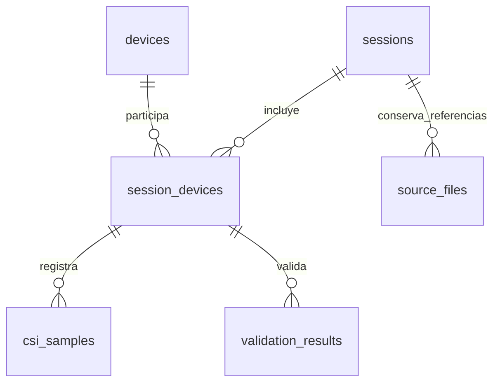

# Capítulo 3: almacenamiento consultable y análisis CSI offline

## Alcance del primer flujo

Se inspeccionaron `src/`, `tools/`, `tests/`, `config/` y la documentación.
El almacenamiento vigente usa bundles brutos, CSV, journal JSONL, manifiestos
y resultados JSON con hashes; no se encontró una implementación consultable
de base de datos en esas rutas. El prototipo añade SQLite de la biblioteca
estándar de Python, sin instalar dependencias ni cambiar el capturador.

El piloto es **RX02-DIAG-VISOR-240S-R1**, una captura física histórica auditada.
Se mantienen los formatos y los originales en
`results/local/diagnostico-rx02-visor-240s-r1/`. La base es un índice derivado,
no reemplaza el bruto ni el journal. No intervienen ESP, UART, red o capturas
nuevas. C04–C06 siguen reservadas. R5-N01 permanece pendiente del ensayo
interactivo y no se incorpora como si tuviera mediciones.

El [perfil de importación](../config/csi_sqlite_pilot.review.json) fija la
sesión, la ruta del bundle, el manifiesto y los hashes del
[informe original](../results/RX02_DIAG_VISOR_240S_R1.md), su evidencia JSON y
la auditoría guardada. No se buscan automáticamente otras capturas.

## Flujo de procedencia y validación

1. Leer los originales y verificar los hashes seleccionados y su inventario.
2. Reutilizar `rx02_physical_report.summarize` y
   `diagnostico_checkpoints_rx02.diagnostic_report`: auditoría nativa de
   integridad, replay, persistencia, identidad, almacenamiento y cierre.
   El resultado debe coincidir con `audit-native.json` y la consolidación previa.
3. Recuperar todas las filas CSI desde las referencias originales de
   `events.json`, usando `verify_reference` y el parser `validate_sample`
   existentes. Comprobar offsets, longitud, SHA-256, IDs y metadatos.
4. Insertar las seis tablas relacionadas dentro de una transacción SQLite.
   Recalcular los indicadores mediante SQL y contrastarlos con el informe.
   Una discrepancia revierte toda la importación de datos.
5. Consultar la vista agregada y exportar un CSV por sesión y receptor.
   Comprobar otra vez que las fuentes no cambiaron.

Se importan las **1.192 filas**, incluidas las anteriores a disponibilidad
inicial. No se toma solo el buffer visual final de ocho filas ni se descartan
los cuatro huecos destacados en el informe. No se interpolan muestras.

## Esquema relacional v1

DDL reproducible: [config/csi_sqlite_v1.sql](../config/csi_sqlite_v1.sql).
SQLite identifica este formato con `application_id=0x43534931` y
`user_version=1`; una base ajena o de versión distinta se rechaza.
`PRAGMA foreign_keys=ON` rige en todas las conexiones.



| Tabla / vista | Clave y contenido |
| --- | --- |
| `devices` | `device_key` estable; tipo y valor de identidad únicos. RX-02 por serial USB `5C93200689`; TX-01 por MAC de origen `1a:00:00:00:00:00`, sin inventar serial USB para TX. |
| `sessions` | `session_id`; protocolo, tipo de evidencia, grupo/partición completos, ruta, huella de entradas, plan y procedencia JSON originales. |
| `session_devices` | PK `(session_id, device_key)`; rol, etiqueta RX/TX, identidad observada JSON y tiempos host de apertura/inicio de cierre/cierre del receptor. |
| `source_files` | PK `(session_id, path)`; tamaño y SHA-256 de los 13 archivos del bundle y tres referencias al informe/auditoría. |
| `csi_samples` | PK `(session_id, device_key, line_1based)`; callback, reloj local, relojes host, RSSI, MAC, drops, offsets, hash de línea, campos CSV originales en JSON, referencia JSON y bytes exactos de la línea. |
| `validation_results` | PK `(session_id, device_key, check_name)`; resultado y detalle JSON para integridad, replay, calidad estricta, cierre, diagnóstico, identidad, almacenamiento y checkpoints. |
| `session_receiver_summary` | Vista SQL con una fila por sesión/receptor, conteos, tiempos, frecuencia, huecos y resultados separados. No incluye una fila de muestras para el transmisor. |

Las muestras mantienen `original_fields_json.data` como la lista int8 original
en su campo CSV, sin transformar orden complejo, LTF, subportadoras o amplitud.
`raw_line` permite comprobar la copia exacta de cada fila. No se inventan
matrices corregidas ni una representación canónica nueva. Arranque, residuos,
líneas inválidas y cola permanecen completos en el bruto original, referenciado
por hash; no se convierten en muestras CSI. Los motivos de rechazo completos,
incluidas sus repeticiones, se conservan en `details_json`.

Los nanosegundos host se guardan como enteros de 64 bits. El reloj local sigue
siendo un uint32 de microsegundos; su diferencia usa módulo 2³². La procedencia
conserva el boot y dominio monotónico originales. No se convierte a UTC ni
se sincronizan relojes entre dispositivos o sesiones sin evidencia.

## Indicadores y fórmulas

Los conteos y diferencias se calculan en la vista sobre las filas almacenadas,
independientemente de los agregados publicados. `LAG` particiona por sesión
y receptor, en el orden de las líneas originales. Los tiempos iguales
producen huecos cero; no se deduplican ni remuestrean.

| Columna | Definición |
| --- | --- |
| `duration_ns`, `duration_s` | Cierre confirmado − apertura. No incluye espera posterior de declaración o finalización del journal. |
| `service_duration_ns`, `service_duration_s` | Inicio de cierre − apertura; evita confundir el cierre solicitado con el cierre confirmado. |
| `rows` | Número de filas CSI completas del receptor en la sesión. |
| `sample_span_ns`, `sample_span_s` | Último − primer retorno host que completó una fila CSI. |
| `capture_frequency_hz` | `(rows−1) / sample_span_s`, la misma cadencia entre extremos usada por el informe original. NULL si no hay al menos dos filas o el intervalo es cero. |
| `rows_per_open_second` | `rows / duration_s`, densidad de filas sobre toda la apertura. Se ofrece aparte porque usa otro denominador. |
| `max_host_gap_ns`, `max_host_gap_ms` | Máxima diferencia entre retornos host de filas consecutivas. No incluye bordes de apertura/cierre: no es el criterio de cobertura con bordes de una ventana E/S. |
| `max_local_gap_us`, `max_local_gap_ms` | Máxima diferencia modular entre timestamps locales consecutivos, separada del reloj host. |
| `quality_status` | `rejected` si la validación estricta original es false; `accepted` si es true; `unknown` si no está registrada. |

Estas frecuencias son **cadencias observadas de filas**, no frecuencia RF
uniforme ni tasa real de paquetes recibidos por la radio. Los huecos no
cuantifican pérdidas RF ni latencia de un solo sentido. Se mantienen separados
`integrity_ok`, `replay_ok`, `close_ok`, `diagnostic_ok` y `strict_quality_ok`.

## Resultado piloto contrastado

| Indicador | SQLite / CSV | Referencia original |
| --- | ---: | --- |
| Apertura → cierre | 240,005564743 s | Tabla de hitos y `lifecycle.open_to_close_ns` |
| Apertura → inicio de cierre | 240,003543760 s | `lifecycle.open_to_closing_ns` |
| Filas | 1.192 | `cadence.complete_rows` |
| Primera → última fila | 239,191988869 s | `cadence.first_to_last_return_ns` |
| Cadencia host | 4,9792637522332885 Hz | `cadence.host_interarrival_hz`; informe: 4,979 Hz |
| Máximo hueco host | 614,782902 ms | `cadence.host_gap_ns.max`; informe: 614,783 ms |
| Máximo hueco local | 601,971 ms | `cadence.local_gap_us.max` |
| Calidad estricta | **Rechazada** | `format:RX-02` ×20 y `preamble_anomaly:RX-02` ×1 |

Integridad, replay, cierre y diagnóstico pasan. Eso no elimina el rechazo
estricto. La sesión permanece en `diagnostic_only`, sin ventanas E/S ni
etiquetas experimentales y con calibración/entrenamiento/producción false.

## Comandos para reproducir el flujo

Desde `/home/alan-monar/tesis-wifi-csi-hibrido`, con el bundle histórico local
disponible y las ESP desconectadas:

```bash
# Crear/reutilizar el índice derivado; reaudita las fuentes antes de importar.
.venv/bin/python -B tools/base_datos_csi.py import-pilot

# Segunda importación: debe devolver already_imported, sin insertar registros.
.venv/bin/python -B tools/base_datos_csi.py import-pilot

# Verificación de fuentes, cada registro importado, métricas y SQLite; solo lectura.
.venv/bin/python -B tools/base_datos_csi.py verify

# Consulta resumida; SELECT de solo lectura.
.venv/bin/python -B tools/base_datos_csi.py query --sql \
  'SELECT session_id, receiver_id, duration_s, rows, capture_frequency_hz, max_host_gap_ms, quality_status FROM session_receiver_summary'

# Exportación nueva; elegir otra revisión si la carpeta ya existe.
.venv/bin/python -B tools/base_datos_csi.py export \
  --output-new results/local/base-datos-csi/csv-r3

# Consulta por muestra, conservando identidad y reloj del receptor.
.venv/bin/python -B tools/base_datos_csi.py query --sql \
  'SELECT callback_id, returned_ns, local_timestamp_us, rssi_dbm FROM csi_samples ORDER BY session_id, device_key, line_1based LIMIT 5'
```

Base creada: `results/local/base-datos-csi/piloto.sqlite3`.
El argumento global `--database RUTA`, antes del subcomando, permite otra base
derivada dentro de `results/local/base-datos-csi/`. El CLI limita sus escrituras
a esa carpeta; jamás usa el directorio del bundle como salida. Las consultas
usan `mode=ro`, `query_only=ON` y un autorizador que permite SELECT/lecturas/
funciones, y rechaza modificaciones, ATTACH y cambios de PRAGMA.

La exportación crea un archivo `SESSION_ID__RECEPTOR.csv`, de una fila de
resumen y saltos de línea LF. Los valores NULL se exportan vacíos. No se
sobrescriben carpetas CSV. La exportación final validada quedó en `csv-r2`.
El [CSV piloto publicado](../results/BASE_DATOS_CSI_PILOTO/RX02-DIAG-VISOR-240S-R1__RX-02.csv)
es una copia agregada idéntica al CSV local; base, muestras y bruto siguen locales.

## Idempotencia, pruebas y límites

La importación usa `BEGIN IMMEDIATE` y claves compuestas. Si la sesión ya
existe, compara todos los registros con las entradas auditadas. Una huella,
identidad, muestra, referencia o validación distinta provoca error, sin
reemplazar el registro anterior. No se usa `INSERT OR REPLACE` ni se ignoran
duplicados de muestras. Un fallo de métricas o integridad revierte la transacción.

Dos importaciones reales dejaron **2 dispositivos, 1 sesión, 2 asociaciones,
16 referencias de archivos, 1.192 muestras y 8 validaciones**. También quedó
idéntico el SHA-256 del archivo SQLite. `integrity_check=ok` y cero errores
de claves foráneas. [Evidencia de ejecución](../results/BASE_DATOS_CSI_OFFLINE.md).

```bash
PYTHONPATH=src:tools:tests .venv/bin/python -B -m unittest test_csi_sqlite -v
```

Pasaron 12 pruebas específicas y 90 en la regresión relacionada, sin fallos,
errores u omisiones. Incluyen rollback, reimportación, identidades en conflicto,
datos alterados, timestamps iguales, wrap local, falta de frecuencia definible,
CSV exclusivo y consultas de solo lectura. Una prueba usa la captura histórica
local y se omite explícitamente si sus originales no están disponibles.
Bubblewrap no pudo crear namespaces en este entorno; estas pruebas se
ejecutaron directamente con barrera de auditoría Python para UART y reserva.

El adaptador v1 admite únicamente el piloto seleccionado, con un receptor y
cierre auditado. El esquema distingue sesiones/dispositivos; incorporar otro
formato, campaña o receptor exige un adaptador y pruebas correspondientes,
sin deducir etiquetas ni promoción de calidad. No se implementaron adquisición
online, migraciones, recuperación de una base editada manualmente o modelos.
