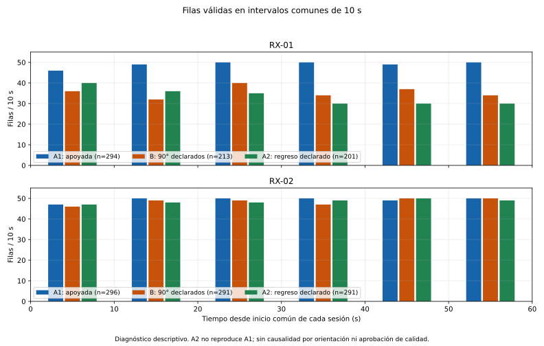
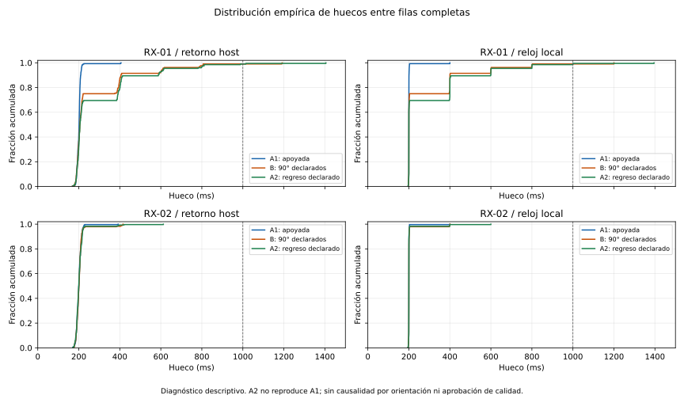
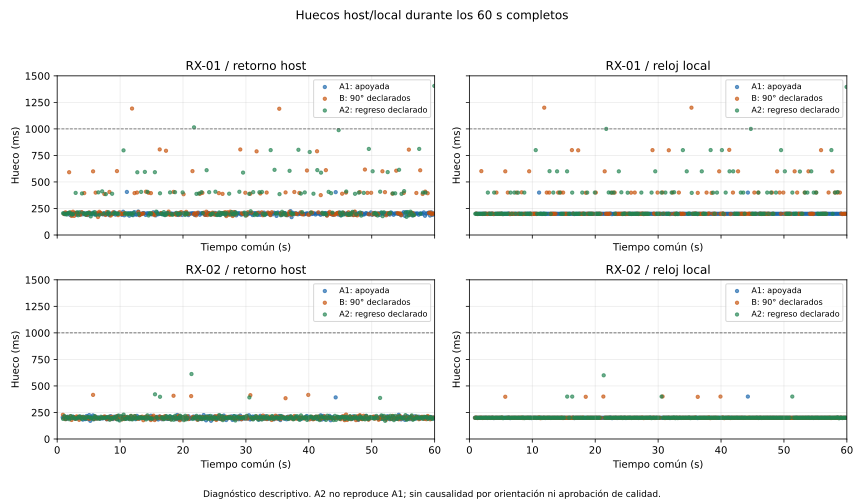
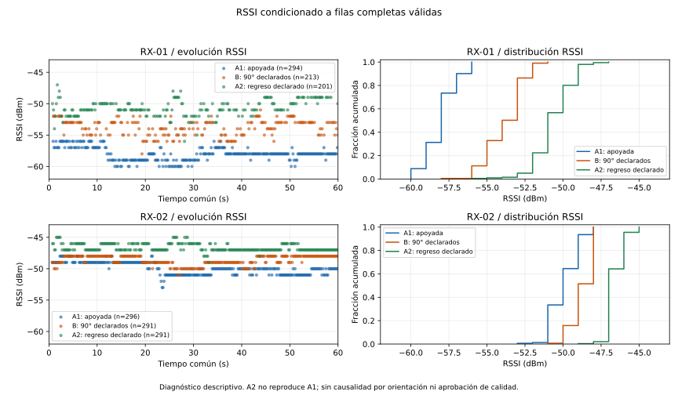
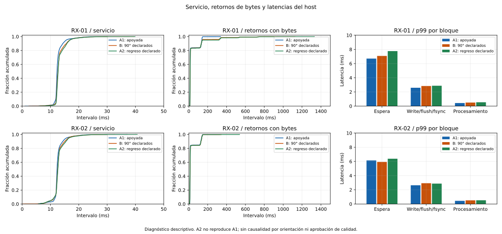

# Serie de antena A1–B–A2: consolidación offline r1

**A2 no reprodujo A1 en los indicadores observados. No se establece causalidad
por orientación.** RX-01 produjo 294, 213 y 201 filas válidas; RX-02, usado como
control, produjo 296, 291 y 291. El RSSI de las muestras válidas aumentó en ambas
identidades a lo largo de la serie. El regreso mecánico declarado no recuperó
la cadencia o distribución de RSSI de A1.

Se auditaron los tres bundles existentes sin abrir UART. Integridad y replay
correctos, 60 s nominales completados, una apertura/cierre por RX en cada intento
y ambos cierres confirmados. Las tres autorizaciones están consumidas; no queda
permiso para más capturas o movimientos. `quality_approval=false` se conserva.
No hay ventanas elegibles, etiquetas de presencia, calibración o entrenamiento.

## Fuentes, método y cronología

Base de adquisición: `4cd768aeea090966777e95bc7df6aded2d8afbdf`. Los ocho hashes
de fuentes registrados durante cada intento coinciden entre sí y con las fuentes
actuales del productor. Los metadatos conservan también el estado del árbol de
trabajo, que incluía los borradores de preparación; no se declara árbol limpio
durante las capturas. No se modifican firmware, parser, perfil, watchdog v4 o
protocolo `continuity-dual-1` para esta comparación.

Entradas locales, cada una íntegra y separada:

- `results/local/continuidad-antena-aba-r3-A1`
- `results/local/continuidad-antena-aba-r3-B`
- `results/local/continuidad-antena-aba-r3-A2`

[Resumen y hashes](COMPARACION_ANTENA_ABA_R3.resumen.json): incluye los 27 archivos
originales, planes capturados, autorizaciones, referencias de montaje, tres fotos,
declaraciones, distribuciones y contrastes descriptivos. Las fotos originales y
brutos permanecen locales. [Manifiesto de gráficos](COMPARACION_ANTENA_ABA_R3.figuras.json):
SHA256, tamaños, versiones y límites verificados de todos los paneles publicados.
Los gráficos se generaron con Matplotlib 3.10.8/NumPy 2.4.2 del runtime local ya
fijado en `requirements-comparacion.txt`; no se instalaron dependencias nuevas.

| Fase | Postura declarada RX-01 | Inicio común UTC, 2026-11-03 | Duración real de observación común |
|---|---|---|---:|
| A1 | Cuerpo móvil apoyado, estado inicial | 21:29:26 | 60,006937558 s |
| B | Solo articulación, 90° hacia arriba | 22:02:40 | 60,012542376 s |
| A2 | Retorno a A1, partes fijas intactas | 22:16:19 | 60,005813066 s |

Entre el fin de lectura anterior y el siguiente inicio común transcurrieron
**32 min 14,127 s** y **12 min 39,131 s**, respectivamente. No fue una observación
continua de 180 s: el orden y esos intervalos permiten deriva temporal/estado.
Las pausas de quietud de 30 s se indicaron en los comandos, sin una traza autónoma
de postura/quietud del operador.

Se usa siempre el intervalo común original `[inicio, inicio+60 s)` por retorno
de lectura, sin buscar recortes favorables. Las filas completas de cada fase
caen dentro de él; los bytes previos de arranque y los eventuales posteriores se
conservan en la conexión. Los huecos son n−1 diferencias entre filas válidas;
las edades inicial/final se informan aparte. Los relojes locales uint32 son
independientes por RX y sesión: no se concatenan sus ids o timestamps.
Cuantiles por rango más próximo `ceil(p*n)`, mediana convencional y muestras sin
relleno ni interpolación. Los puntos de varios gráficos pueden superponerse.

## Cadencia y cobertura: A2 conserva la reducción de RX-01

| Identidad/fase | Filas válidas | Filas/s sobre 60 s | Incidencias host >1 s | Cola sin LF |
|---|---:|---:|---:|---:|
| RX-01 A1 | 294 | 4,900 | 0 | 0 bytes |
| RX-01 B | 213 | 3,550 | 2, recuperadas | 0 bytes |
| RX-01 A2 | 201 | 3,350 | 2, recuperadas | 0 bytes |
| RX-02 A1 | 296 | 4,933 | 0 | 0 bytes |
| RX-02 B | 291 | 4,850 | 0 | 0 bytes |
| RX-02 A2 | 291 | 4,850 | 0 | 0 bytes |

RX-01: B−A1 = −81 filas; A2−A1 = **−93 filas (−31,63 %)**; A2−B = −12.
RX-02: −5, −5 y 0. El cociente descriptivo RX-01/RX-02 cambia de 0,9932 a
0,7320 y 0,6907; no es una fracción de paquetes RF recibidos. Promediar ambos A
da 247,5 filas y B−promedio(A) = −34,5, pero oculta la diferencia de 93 entre A1
y A2 si no se muestran sus valores: tampoco ese contraste es un efecto causal.

Filas válidas por cada 10 s:

| Identidad/fase | 0–10 | 10–20 | 20–30 | 30–40 | 40–50 | 50–60 |
|---|---:|---:|---:|---:|---:|---:|
| RX-01 A1 | 46 | 49 | 50 | 50 | 49 | 50 |
| RX-01 B | 36 | 32 | 40 | 34 | 37 | 34 |
| RX-01 A2 | 40 | 36 | 35 | 30 | 30 | 30 |
| RX-02 A1 | 47 | 50 | 50 | 50 | 49 | 50 |
| RX-02 B | 46 | 49 | 49 | 47 | 50 | 50 |
| RX-02 A2 | 47 | 48 | 48 | 49 | 50 | 49 |



## Huecos host y reloj local

| Identidad/fase | Host media / p95 / máximo, ms | Local media / p95 / máximo, ms |
|---|---:|---:|
| RX-01 A1 | 201,387 / 212,878 / 405,874 | 201,365 / 201,748 / 400,008 |
| RX-01 B | 278,361 / 609,885 / 1191,937 | 278,301 / 600,020 / 1200,102 |
| RX-01 A2 | 296,077 / 614,248 / 1405,115 | 295,999 / 600,086 / 1395,473 |
| RX-02 A1 | 200,686 / 217,629 / 392,083 | 200,678 / 201,741 / 400,010 |
| RX-02 B | 204,165 / 217,740 / 415,802 | 204,138 / 202,241 / 400,884 |
| RX-02 A2 | 204,093 / 219,454 / 612,339 | 204,138 / 201,901 / 600,020 |

Las medianas locales siguen alrededor de 200 ms en todas las fases, pero RX-01
acumula más intervalos largos en B y A2. Por eso la mediana sola no resume la
cadencia. La reducción también está representada en el reloj local del firmware;
no se explica como una pausa de un segundo medida únicamente al persistir.

| Incidencia RX-01 | Id anterior→recuperación | Hueco host | Hueco local |
|---|---|---:|---:|
| B, primera | 39→40 | 1191,936676 ms | 1200,018 ms |
| B, segunda | 122→123 | 1190,004383 ms | 1200,102 ms |
| A2, primera | 79→80 | 1014,693504 ms | 1000,001 ms |
| A2, segunda | 199→200 | 1405,114678 ms | 1395,473 ms |

Todas se recuperan sin saltar id ni aumentar queue_drops. En A2 la primera
termina a 21,753350 s comunes y la última a 59,947988 s; su recuperación cercana
al deadline es una fila completa, no una cola reconstruida. Los ids, offsets,
hashes y referencias de lectura se conservan en los artefactos locales completos.
No se cambia el umbral estricto >1 s para modificar el número de incidencias.





## RSSI y control RX-02

| Identidad/fase | n | Media dBm | Mediana dBm | p10–p90 dBm | Rango dBm |
|---|---:|---:|---:|---|---|
| RX-01 A1 | 294 | −58,037 | −58 | −59…−57 | −60…−56 |
| RX-01 B | 213 | −53,808 | −54 | −56…−52 | −58…−51 |
| RX-01 A2 | 201 | −50,647 | −51 | −52…−49 | −56…−47 |
| RX-02 A1 | 296 | −49,936 | −50 | −51…−49 | −53…−48 |
| RX-02 B | 291 | −48,680 | −49 | −50…−48 | −51…−48 |
| RX-02 A2 | 291 | −46,622 | −47 | −47…−46 | −49…−45 |

Las medias A2−A1 aumentan **7,391 dB en RX-01 y 3,314 dB en RX-02**. B queda
entre ambos A para RSSI, mientras A2 tiene todavía menos filas que B en RX-01.
El control mantiene aproximadamente su cadencia, pero **no mantiene su RSSI**.
Esa evolución compartida limita una explicación basada solo en el giro de RX-01.

RSSI está condicionado a las filas que llegaron y fueron válidas; no conocemos
el RSSI de eventos no observados. Mayor RSSI de esa población no demuestra más
recepciones o menos pérdida RF. No se infieren SNR, sensibilidad, ganancia,
interferencia o potencia TX causal a partir de esos valores aislados.



## Callbacks, descartes, perfil y transporte

Ids completos por fase, todos consecutivos desde cero: RX-01 0…293, 0…212,
0…200; RX-02 0…295, 0…290, 0…290. `queue_drops=0` en todas las filas, sin
reinicios/saltos de id o discontinuidades locales según la gramática existente.
Esos ids se incrementan después del filtro del callback: no son secuencia TX ni
un contador de toda recepción RF; cero descartes no cubre pérdidas anteriores
al callback/filtro o posteriores al último dato observado.

Perfil constante en las seis combinaciones: fuente `1a:00:00:00:00:00`, canal 11,
bandwidth=0/HT20, sig_mode=1, mcs=0, stbc=0, rx_state=0, len=256,
first_word_invalid=0. No hay errores/reset/líneas inválidas posteriores al primer
CSI completo. Los textos y residuos iniciales siguen íntegros y clasificados
como en el original, incluido el sniffer de arranque RX-01. No se aprueba la
conexión por eliminar el preámbulo o admitir texto genérico.

| Identidad/fase | Bytes de conexión | Lecturas en los 60 s | Servicio máximo | read máximo | Espera previa a persistir p99 | Persistencia bruto p99 | Procesamiento p99 |
|---|---:|---:|---:|---:|---:|---:|---:|
| RX-01 A1 | 243097 | 1847 | 37,831 ms | 0,506 ms | 6,701 ms | 2,591 ms | 0,437 ms |
| RX-01 B | 182726 | 1310 | 39,509 ms | 0,427 ms | 7,079 ms | 2,836 ms | 0,505 ms |
| RX-01 A2 | 174290 | 1218 | 39,861 ms | 0,310 ms | 7,760 ms | 2,873 ms | 0,544 ms |
| RX-02 A1 | 255822 | 1944 | 37,105 ms | 0,245 ms | 6,145 ms | 2,639 ms | 0,444 ms |
| RX-02 B | 249303 | 1868 | 32,626 ms | 0,438 ms | 5,930 ms | 2,928 ms | 0,519 ms |
| RX-02 A2 | 251512 | 1861 | 40,640 ms | 0,290 ms | 6,383 ms | 2,874 ms | 0,524 ms |

Los bloques no son filas ni paquetes RF. Hay 2/2/3 lecturas RX-01 anteriores al
inicio común; RX-02 no tiene lecturas previas. No hay lecturas posteriores al
deadline en esta serie; las colas finales de los seis flujos son cero bytes.
Los tiempos de persistencia máxima del bruto llegan a 18,774 ms y la espera
máxima previa, a 21,313 ms, muy por debajo de los huecos de un segundo observados.
El journal compartido aporta latencia; su fsync no está aislado del servicio.
El procesamiento p99 aumenta algo en ambos RX entre A1 y A2, sin que esto localice
la causa de los huecos representados también en el reloj local.

Ningún intervalo de servicio observado llega a 1 s. Las diferencias de spans
BOOTTIME−MONOTONIC son −1220, +1105 y +420 ns; no aparece señal de suspensión
global de escala 1 s en esos relojes. El muestreo no es simultáneo. No hay
trazas de cada resultado de select, USB URBs, overrun UART, tarea/callback o RF;
no se excluye toda influencia de host/driver por observar servicio continuo.
Los 239/240/239 controles de almacenamiento no registran fallo, con más de
113 mil millones de bytes libres. No se fuerza ningún criterio de CSI a partir
de estos tiempos para conseguir aprobación.



## Límites causales y siguiente experimento mínimo

La intervención y su retorno están documentados mediante declaraciones, fotos
de referencia y croquis relativo confirmado, sin metrología angular o fotografías
de B/A2 que prueben la repetición exacta de la geometría. No se afirma que el
operador haya movido otra pieza; tampoco se certifica precisión no medida.
No hay salida/código de los preflights archivados: se registra la comunicación
del operador; el runtime sí revalidó identidades y fd antes/después de abrir.
RX-01 pasa por hub y RX-02 directo según metadatos previos y seguimiento visual;
esa diferencia no se manipula ni se aísla en esta serie.

Cada intento reabre UART y conserva logs de arranque. El backend solicita DTR/RTS
false pero no excluye transitorios eléctricos ni atestigua el firmware instalado.
Por tanto, tiempo, estado al arrancar/abrir, entorno radioeléctrico no observado
y precisión del retorno siguen siendo alternativas. No se identifican placa,
antena, coaxial, filtro/driver, USB o TX como causa. A2 distinto de A1 impide
presentar el patrón como una respuesta reversible demostrada a orientación;
un efecto de orientación tampoco queda descartado con este diseño único.

**Siguiente experimento mínimo propuesto: A–A estático**, dos intentos nuevos de
60 s manteniendo la postura A actual y todo el montaje inmóvil, con el mismo
protocolo, RX-02 como control, pausa breve predefinida/registrada entre sesiones
y referencias de geometría antes/después. No hacer el giro ni cambiar puerto,
cable, alimentación, firmware o criterios. Esto permitiría comprobar si cambian
cadencia/RSSI entre aperturas aun sin manipulación de antena.

Si varían también en A–A, respaldaría falta de repetibilidad del conjunto en esas
condiciones, sin separar tiempo, entorno, apertura o estado interno. Si resultan
parecidos, solo describiría ese par; no demostraría estabilidad general ni
causalidad de orientación y no justificaría calibrar presencia. Una evaluación
posterior de orientación necesitaría replicación y control del orden/tiempo.
No se compra instrumentación ni se prepara aquí un comando de adquisición.
Es una propuesta sin ejecutar: requiere plan y autorización nuevos; las tres
autorizaciones actuales están consumidas.

## Reproducción y validación

```bash
PYTHONDONTWRITEBYTECODE=1 .venv/bin/python -B tools/comparar_antena_aba.py \
  --output-new results/local/comparacion-antena-aba-REPRODUCCION-NUEVA
PYTHONDONTWRITEBYTECODE=1 PYTHONPATH=src:tests .venv/bin/python -B \
  -m unittest test_antenna_aba_analysis -v
```

La herramienta audita los originales, verifica planes/autorizaciones y referencias
de montaje, calcula las observaciones y crea exclusivamente una salida nueva
fuera de los bundles. El JSON completo y muestras para los gráficos quedan en
`results/local/consolidacion-antena-aba-r3-r1/artefactos-r1/`. No publica matrices
CSI ni modifica datos al representar. Los SVG publicados tienen escalas comunes;
los PNG locales se inspeccionaron visualmente en los cinco gráficos.

279 pruebas aprobadas en 29,719 s, cero omisiones: 269 de regresión y diez nuevas
de comparación, cuantiles RSSI, trazabilidad, rechazo de alteraciones y gráficos
con ejes comunes/sin recortes silenciosos. Los resultados de pruebas, preservación
por hashes y entorno gráfico se registran en el resumen y manifiesto. No se atribuye aislamiento de Bubblewrap a las
pruebas directas. La auditoría, gráficos y consolidación no abrieron UART,
repitieron capturas, movieron antenas o modificaron firmware/modelos.
