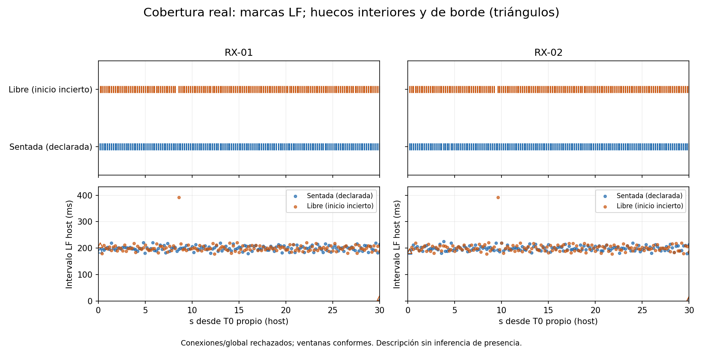
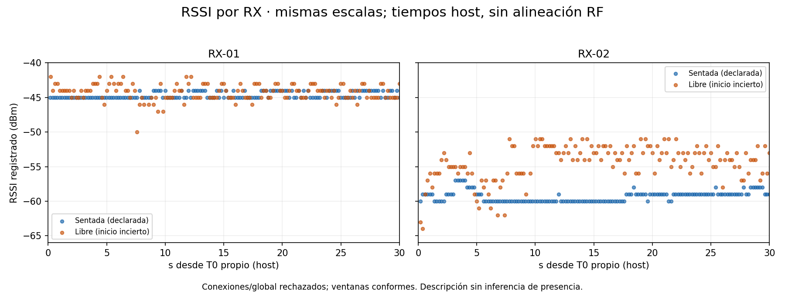
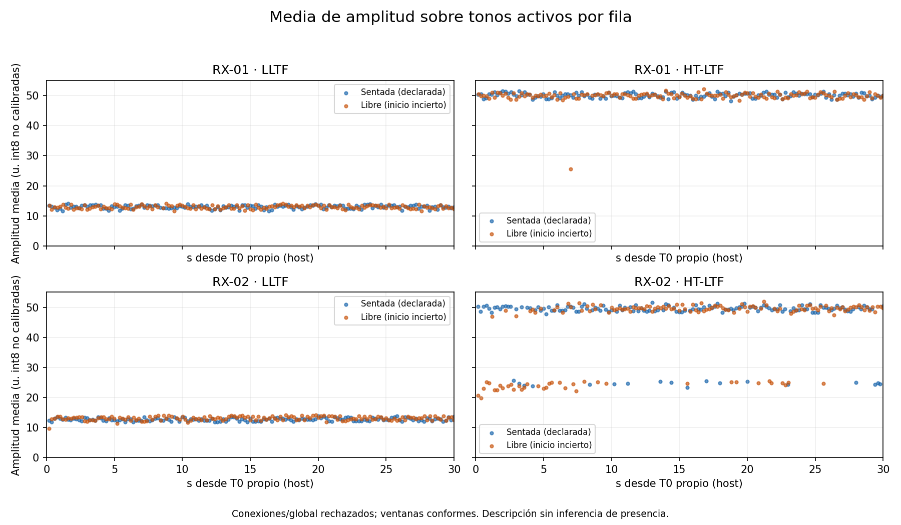
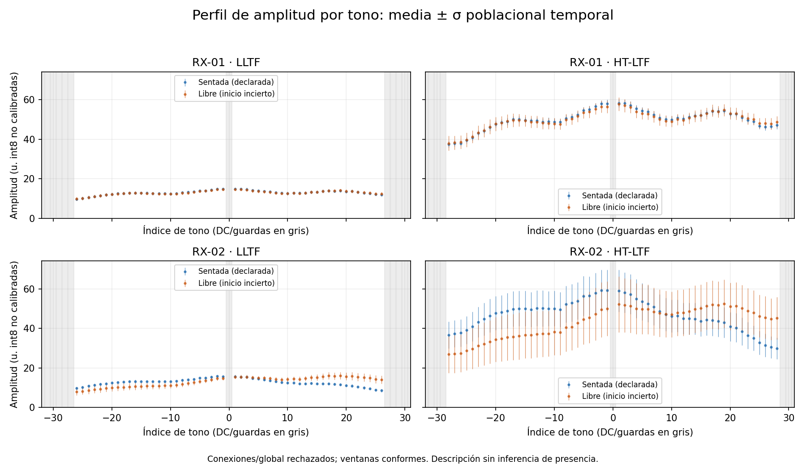
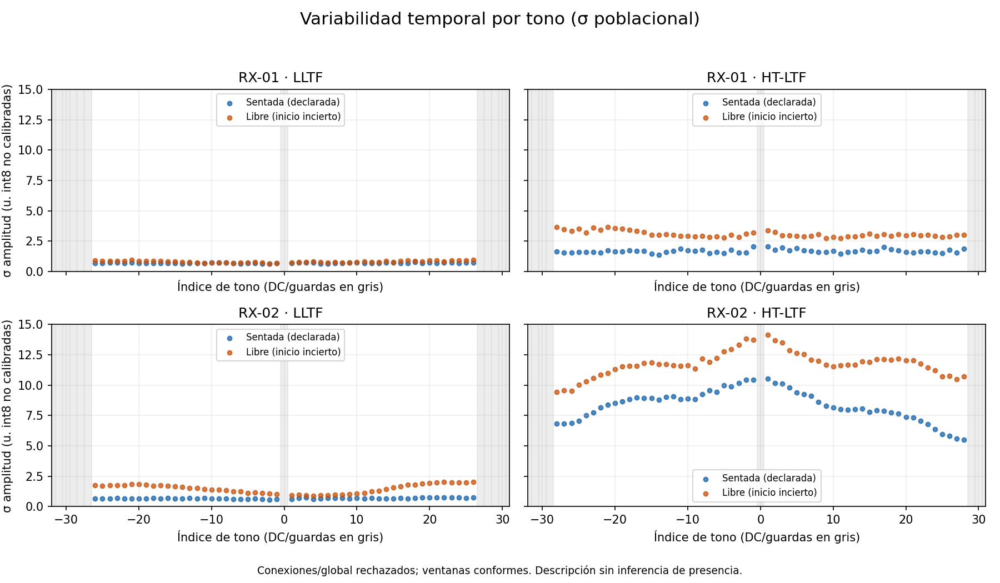

# Comparación descriptiva offline: sesión sentada y movimiento libre v3

**Dos ventanas físicas originales, sin concatenar ni sustituir intervalos. Ambas conexiones/global siguen rechazadas y ambas ventanas son conformes al contrato v3.** No se ajustó un umbral, calibró, entrenó o ejecutó un detector. Estos contrastes no son detección de presencia, precisión o efecto causal del movimiento.

Fuentes: [sesión sentada consolidada](CAPTURA_FISICA_V3.md) y [movimiento libre consolidado](CAPTURA_MOVIMIENTO_LIBRE_V3.md). [Estadísticas y procedencia reproducibles](COMPARACION_FISICA_V3.resumen.json); [hashes de las diez figuras y runtime](COMPARACION_FISICA_V3.figuras.json). Solo se versionan informes, referencias/hashes y derivados descriptivos, sin CSV, brutos, canónicos o matrices IQ.

## Comparabilidad antes de interpretar

| Aspecto | Sentada | Movimiento libre | Alcance comprobado |
|---|---|---|---|
| Adquisición UTC | 26-oct-2026 00:54:53–00:55:24 | 26-oct-2026 04:08:25–04:08:56 | Más de tres horas entre sesiones, sin control de cambios ambientales intermedios. |
| Commit general | `513be6037308015605b9a3ab41b2e70badd901ef` | `cef86ef1df0de1a65c34826e04763bf37e0031b4` | **Las mismas 14 fuentes/perfil de adquisición por SHA-256**, contrastadas con ambos commits; los commits generales distintos no implican firmware distinto. |
| Persona y etiqueta | Una persona, sentada/quieta ante laptop, declarada | Una persona haciendo tareas normales; inicio físico incierto después de enviar autorización | Sin observación continua ni sincronización instrumental de etiquetas. No afirmar actividad continua en la segunda. |
| Montaje | Un RX a cada lado; TX a algo más de 2 m, aproximado | Declara mismas posiciones de laptop, TX, RX y cables | Sin coordenadas medidas o asignación izquierda/derecha por USB; igualdad física **declarada**, no demostrada. El movimiento cambia la posición de la persona, sin trayectoria registrada. |
| Alimentación | TX cargador de pared, RX USB | La misma clase de alimentación declarada | No se midieron tensión, ruido, orientación efectiva o propagación. |
| Identidades | RX-01 `5C93199744`, RX-02 `5C93200689` | Las mismas | by-id, VID/PID `1a86:55d3`; los dos preflight históricos resolvieron RX-01→ttyACM0 y RX-02→ttyACM1. Se comparan identidades, sin suponer persistencia de los números. |
| Perfil/configuración | ESP32-S3, IDF v5.4, canal 11 HT20, fuente `1a:00:00:00:00:00`, 115200 | Igual por perfil/hashes y campos de filas | Perfil SHA `c39115ee2a789e8a8b3aa372528f869a6ac9fe5f92847b427ad4075d78f3c048`. Binario instalado **no atestado**. |
| CSI observado | 256 bytes, int8 Im/Re, dos bloques de 64 pares, no STBC | Igual | Separar LLTF y HT-LTF; no son dos antenas ni 128 tonos consecutivos. Modelo de índices condicionado a fuentes/metadatos, sin reescribir campos históricos del perfil. |
| Merge/filtro/escala | `ltf_merge_en=true`, `channel_filter_en=true`, autoescala `manu_scale=false` | Igual en las fuentes fijadas | HT-LTF condicionado al merge; filtro/ganancia/AGC no se deshacen. Amplitud sin calibración absoluta ni comparabilidad de ganancia garantizada entre sesiones/RX/LTF. |
| Capturador/serial | `controlled_dual_v3`, pySerial 3.5 y hash POSIX fijado | Iguales | READY+3 filas, frescura 1 s, espera 10 s, ventana 30 s, cierre 250 ms/65536 bytes. Sin flush, recortes o reintentos. |
| Arranque | Residuos/texto de arranque; reconexión previa de placas/hora no especificadas | Residuos/texto de arranque conservados; sin reset/reconexión enviados por el intento | Las aperturas separadas no son una prueba controlada de READY repetible. Causas iniciales indeterminadas. |

Los conjuntos de valores de los campos PHY comparados coinciden, excepto **`noise_floor` en RX-02**: en sentada son −96…−93; en libre −96…−92, con −92 en 120/149 filas frente a ninguna en sentada. RX-01 conserva −95…−90 en ambas. Las distribuciones completas están en JSON; los conteos también cambian por 150 frente a 149 filas. `noise_floor` es metadato registrado, no medida independiente de interferencia ni prueba de una causa. No se igualan artificialmente RSSI, escala o nivel de ruido.

## Ventanas y cobertura preservadas

| Sesión/RX | Completas | Incluidas | Excluidas completas | Hueco inicio | Hueco fin | Máximo hueco host |
|---|---:|---:|---|---:|---:|---:|
| Sentada RX-01 | 154 | 150 | 4 preámbulo | 190.832 ms | 0.397 ms | 221.799 ms |
| Sentada RX-02 | 153 | 150 | 3 preámbulo | 186.379 ms | 5.328 ms | 225.906 ms |
| Libre RX-01 | 152 | 149 | 3 preámbulo | 211.034 ms | 11.057 ms | 391.361 ms |
| Libre RX-02 | 152 | 149 | 3 preámbulo | 189.107 ms | 9.209 ms | 391.837 ms |

T0/T1 originales (ns monotónicos host): sentada **21061663479670 / 21091663479670**; libre **32673761518285 / 32703761518285**. Disparo tras A: 1.264235967 s y 1.169400541 s. Cada ventana mide 30 s; no se retrocede T0 ni se crean ventanas nuevas sobre otras capturas. Las filas incluyen su primera lectura ≥T0 y retorno LF <T1. Hay 5.000 y 4.966667 filas/s por conteo/30 s respectivamente, con huecos e irregularidad conservados. No son tasas RF uniformes o sincronizadas.



[SVG de cobertura](figures/comparacion_v3/cobertura.svg). Cada marca superior es un retorno LF real; puntos inferiores son huecos interiores, triángulos son bordes. El eje de tiempo 0–30 s es **relativo al T0 de cada sesión**, no emparejamiento RF entre sesiones o RX. Los intervalos no se rellenan y no se aplica el límite de cobertura propuesto para el piloto.

## Método descriptivo fijado para esta comparación

Se usan exclusivamente las filas incluidas por las auditorías originales y reproducidas. Para cada fila/bloque, amplitud = `hypot(Re,Im)` sobre los int8 originales. El canónico reconstruido conserva orden complejo, índices y máscaras. Se consideran datos+pilotos: **52 tonos LLTF y 56 HT-LTF**, excluyendo DC y guardas; la máscara hardware se conserva separada. Todos los tonos activos requeridos de estas ventanas son válidos: 150 o 149 observaciones reales por tono, sin invalidez activa ni ceros activos observados. Eso no justifica omitir máscaras en otras sesiones.

La media por fila pondera igual los tonos activos. Su media y σ poblacional temporal ponderan igual las filas, sin ponderar duración ni inventar una malla uniforme. La otra medida de variabilidad es **σ poblacional de amplitud por tono a lo largo de sus filas válidas**, y después la media de esas σ. Son estadísticas diferentes: no confundir la variación de una media espacial con el promedio de variaciones por tono. El JSON mantiene también cada tono, su n, media, mínimo/máximo y σ.

Si faltase un tono activo, la fila seguiría en su sesión, su media espacial completa sería no evaluable y se registrarían soportes por tono; nunca cero inventado, máscara optimizada o eliminación silenciosa. No hubo esa exclusión adicional aquí. Los ceros válidos de amplitud se conservarían; fase de cero no se usa. No se analizan fase, FFT, Doppler, respiración o bandas temporales a una frecuencia supuesta.

Mismas escalas lineales en ambos conjuntos y todos los paneles comparables: tiempo **0–30 s**; RSSI **−66…−40 dBm**; amplitud media por fila **0–55**; perfil media±σ **0–74**; σ por tono **0–15**; índice de tono **−32…31**; huecos **0–432 ms**. Los rangos engloban ambos conjuntos, sin centrar/normalizar cada sesión o escoger recortes favorables. Las barras ±σ describen dispersión, **no intervalos de confianza**. Las figuras usan puntos en los tiempos reales, sin conectar muestras para aparentar observación continua. El exportador comprueba los límites efectivos de cada panel contra estos rangos y los registra en el JSON de figuras.

## RSSI por receptor

| RX | Sentada: media / σ (dBm) | Libre: media / σ (dBm) | Diferencia de media libre−sentada |
|---|---:|---:|---:|
| RX-01 | −44.633 / 0.482 | −44.235 / 1.149 | +0.398 dB |
| RX-02 | −59.307 / 0.765 | −54.409 / 2.598 | +4.897 dB |



[SVG RSSI](figures/comparacion_v3/rssi.svg). RSSI pertenece a la fila; no se duplica por LTF como evidencia independiente. En esta pareja de sesiones aumenta la media y la dispersión de RSSI, de distinta magnitud por RX. No se interpreta como probabilidad de presencia o efecto exclusivamente del movimiento.

## Amplitud y variabilidad, por RX y LTF

Unidades de amplitud derivadas del int8, **sin calibrar**. En cada celda se muestra sentada → libre.

| RX/LTF | Media de medias por fila | σ temporal de la media por fila | Media de σ temporal por tono |
|---|---:|---:|---:|
| RX-01 LLTF | 13.018 → 12.958 | 0.572 → 0.562 | 0.694 → 0.805 |
| RX-01 HT-LTF | 50.115 → 49.850 | 0.751 → 2.120 | 1.679 → 3.082 |
| RX-02 LLTF | 12.725 → 13.100 | 0.499 → 0.661 | 0.672 → 1.474 |
| RX-02 HT-LTF | 46.623 → 43.085 | 8.150 → 11.250 | 8.346 → 11.771 |



[SVG amplitud por fila](figures/comparacion_v3/amplitud_fila.svg). La media LLTF cambia poco en RX-01 y algo más en RX-02; las diferencias HT-LTF son distintas en cada receptor. Se observan grupos de amplitud HT-LTF diferentes, **también en sentada**, especialmente RX-02. Todas esas filas permanecen: no se clasifican como outliers para retirarlas ni se compensan por un factor supuesto. No se demuestra si intervienen ganancia/autoescala, propagación, hardware u otra causa.



[SVG perfil por tono](figures/comparacion_v3/amplitud_tono.svg). DC/guardas en gris, sin amplitudes artificiales. Los bloques se muestran por separado incluso cuando su fuente tiene merge activo; no se infiere una geometría espacial desde subportadoras.



[SVG variabilidad](figures/comparacion_v3/variabilidad_tono.svg). La media de σ por tono es mayor en libre en las cuatro vistas, pero la σ de la **media por fila** LLTF de RX-01 disminuye levemente. El resultado depende de la magnitud descriptiva elegida; no se busca un umbral o rasgo que separe las etiquetas. La elevada variabilidad HT-LTF de RX-02 ya en sentada impide tratar «más variación» como una validación de movimiento/presencia.

## Qué permanece sin demostrar

Dos sesiones de una persona presente, sin sesión vacía comparable, no permiten estimar precisión, falsos positivos, sensibilidad o generalización. Las filas vecinas no son réplicas independientes: no se calculan p-values, intervalos de confianza o pruebas de significación usando cientos de filas como cientos de sesiones. No hay reparto entrenamiento/prueba ni ajuste de ningún parámetro de detector.

No se conoce el comienzo físico exacto ni continuidad de las tareas en libre. La sesión sentada tampoco tiene seguimiento instrumental de postura. La declaración de posiciones fijas no controla el entorno durante las tres horas intermedias, ganancias/AGC, interferencia, orientación de la persona o época de arranque. Se describen **estos registros**, sin atribuir causalmente sus diferencias al movimiento ni inventar sincronización RF.

Las conexiones y globales rechazados permanecen visibles. La anomalía de autoentrada vacía del manifiesto auxiliar antiguo de la sesión sentada sigue expuesta en su informe; el reproductor verifica las demás entradas y no extiende esa excepción a otros hashes o a movimiento libre. No se limpia el arranque para aprobar ni se relajan criterios. La segunda sesión sigue explícitamente fuera del piloto, calibración y entrenamiento. Cualquier adquisición futura requiere autorización nueva.

## Reproducción y verificaciones

[Código offline](../tools/comparar_fisicas_v3.py), [diez pruebas](../tests/test_comparar_fisicas_v3.py) y [resultados/hashes de verificación](COMPARACION_FISICA_V3.validacion.json). Requieren los originales locales fijados; si faltan o cambian, se rechaza la reproducción, sin descargarlos, inventarlos o adquirir otros.

Para disponer del runtime de figuras en un directorio aislado (ya preparado aquí mediante ruedas binarias, sin scripts remotos ni cambio de `.venv` de captura):

```sh
.venv/bin/python -m pip install --only-binary=:all: \
  --target .tools/comparacion-v3-python-v2 -r requirements-comparacion.txt
```

Generar otros derivados nuevos, nunca sobrescribir originales ni la salida previa:

```sh
.venv/bin/python -B tools/comparar_fisicas_v3.py \
  --output-new results/local/COMPARACION-V3-NUEVA
```

El reproductor usa Bubblewrap: fuentes de solo lectura, salida nueva escribible, red aislada y `/dev` privado. Solo calcula estadísticas/figuras; no puede escoger otra ventana ni llamar a una adquisición. Matplotlib 3.10.8 y NumPy 2.4.2, con dependencias fijadas y fuentes DejaVu; SVG sin fecha dinámica y semilla de identificadores fija. No se usan funciones RuView de entrenamiento/inferencia: se verifica la representación canónica ya auditada.

Comprobar ambos JSON publicados y los hashes de las diez figuras, sin regenerar capturas o tocar resultados:

```sh
.venv/bin/python -B tools/comparar_fisicas_v3.py --check results
./tools/offline_sandbox.sh .venv/bin/python -B -m unittest discover \
  -s tests -p test_comparar_fisicas_v3.py -v
```

Las diez pruebas pasaron sin omisiones: máscaras/DC/guardas, ceros válidos, tonos ausentes sin relleno, ausencia total, datos no finitos, cambio de layout, fronteras prospectivas, timestamps repetidos, manifiesto alterado y reproducción/preservación de los originales con UART/discovery bloqueados. Se revisaron las cinco figuras y sus límites comunes; comparación final de **507 archivos anteriores intactos**. No se repitió la suite de adquisición por este trabajo offline ni se ejecutó otra captura, reset o cambio de firmware.
