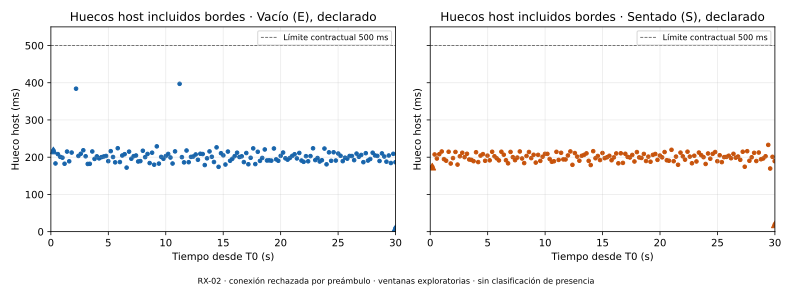
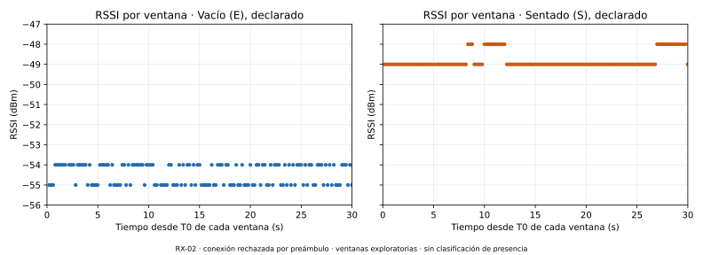
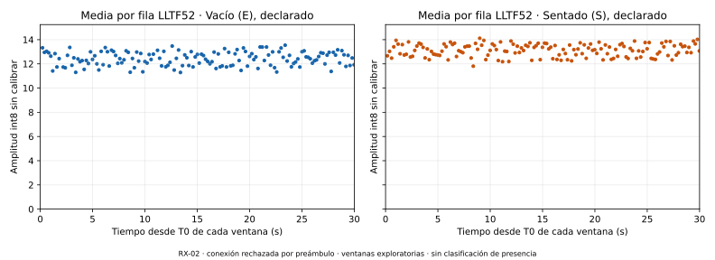
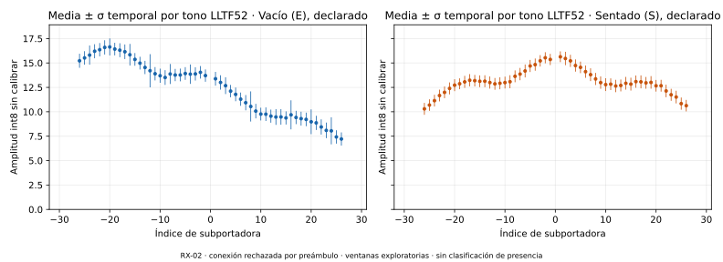
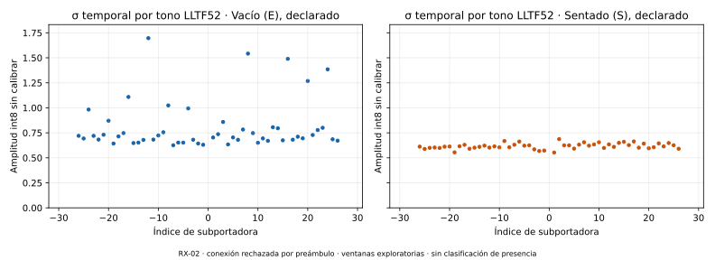

# RX02-C01: auditoría y comparación descriptiva vacío/sentado

**Integridad y replay correctos; ambas ventanas elegibles exclusivamente para
exploración. La conexión completa conserva su rechazo por el preámbulo.** RX-02
cerró con recibo durable; la autorización del intento está consumida. No se
calibró, entrenó, clasificó presencia ni ajustó un umbral. Una conexión y dos
ventanas de orden fijo no permiten evaluar precisión ni atribuir causalidad.

Fuentes originales: `results/local/piloto-rx02-r1-C01`, adquiridas por el operador
desde su terminal normal. Los **14 archivos originales, incluidos bruto,
operaciones, eventos, resúmenes, autorización, recibo y cinco WAV, permanecen
idénticos por tamaño/SHA-256** antes y después del análisis. No se escribieron
archivos dentro del bundle. Se publican este informe, [resumen con referencias
y hashes](RX02_C01.resumen.json), [manifiesto de figuras](RX02_C01.figuras.json),
[validación](RX02_C01.validacion.json) y [manifiesto de publicación](RX02_C01.archivos.json).
Los brutos y las matrices por fila permanecen locales.

## Auditoría separada por resultado

| Resultado | Evidencia reproducida |
|---|---|
| Integridad | Manifiesto, conjunto de archivos, tamaños y hashes correctos; bytes leídos contiguos y completamente referenciados. |
| Replay | 103.382 operaciones reproducidas; estado y eventos idénticos al original. |
| Conexión completa | `quality_ok=false`; razones `format:RX-02` y `preamble_anomaly:RX-02`. No se reclasifica como conforme. |
| Preámbulo | `anomalous_uninterpreted`; 7.308 bytes sellados antes de ambas ventanas, 88 entradas anómalas registradas, sin eliminarlas ni tratarlas como CSI. |
| Ventana E | Calidad de ventana, cobertura y etiqueta conformes; certificación `eligible_exploratory`. |
| Ventana S | Calidad de ventana, cobertura y etiqueta conformes; certificación `eligible_exploratory`; `last=true`. |
| Transporte/almacenamiento | Identidad y almacenamiento certificados por el auditor; `fatal=null`, sin fallos exploratorios registrados. |
| Cierre | Un cierre de RX-02 confirmado, lector detenido y recibo durable verificado; cero bytes de cola. |
| Autorización | `Alan-RX02-C01-20261104-unico-intento`, consumida antes del intento de apertura; `retry_allowed=false`. |

El campo original `windows[].eligible=false` aplica la calidad de **toda la
conexión**. Se conserva junto con el resultado posterior y separado de
`exploratory_eligibility.windows[].eligible=true`, que verifica integridad,
replay, identidad, almacenamiento, fronteras, cobertura, etiqueta y cierre.
No se sustituye uno por el otro ni se eleva la elegibilidad a aptitud para modelos.

La conexión contiene **3.299 filas CSI**, ids consecutivos 0…3298 y
`queue_drops=0`. De ellas, 298 pertenecen a las dos ventanas y **3.001 quedan
fuera**; no se añaden a la comparación ni se recortan del original. El registro
clasifica además 69 líneas `info`, 20 `invalid`, dos `neutral`, una `reset` y
una `ready`: 3.392 líneas en total. Las entradas anómalas son la clasificación
original del preámbulo, no 88 filas CSI o 88 errores UTF-8.

Hay una apertura y un cierre, 19.903 chunks, dos solicitudes manuales y dos
declaraciones; `retry_count=0`. El intervalo apertura→cierre es
**664,114355399 s**. El journal completo abarca 745,440024111 s porque incluye
la declaración final posterior al cierre; no equivale a duración de adquisición.
Los callbacks no son una secuencia TX ni miden pérdidas RF anteriores al filtro.

## Ventanas, cobertura y etiquetas originales

| Condición declarada | T0 / T1 host monotónicos, ns | Filas | Bins consecutivos de 5 s | Hueco inicio / fin | Máximo hueco con bordes |
|---|---|---:|---|---|---:|
| Vacío E | 1388146280317 / 1418146280317 | 148 | 24, 24, 24, 25, 25, 26 | 218,010 / 9,440 ms | 397,045 ms |
| Sentado S, última | 1661359117832 / 1691359117832 | 150 | 25, 25, 25, 25, 25, 25 | 174,532 / 19,544 ms | 233,026 ms |

Se usan exclusivamente los intervalos prospectivos originales de **30 s**, sin
mover T0/T1 ni buscar segmentos favorables. Las fronteras conservadoras exigen
primera lectura de cada fila desde T0 y retorno LF anterior a T1, además de
lecturas/bytes posteriores a la frontera de arranque y procesamiento antes de
T1. Los conjuntos conservadores y originales coinciden en las 148/150 filas.
Las referencias completas conservan número de línea, offsets, longitud,
SHA-256, índices de lectura, id callback, reloj local y tiempos host.

Se reprodujeron los criterios previos, sin cambios: mínimo 120 filas, mínimo
15 por bin de 5 s y hueco máximo 500 ms, incluidos bordes. Ambas ventanas los
cumplen. Conteo/30 s = 4,933333 y 5 filas/s; no se interpreta como frecuencia RF
uniforme. Entre el final de E y T0 de S hay **243,212837515 s**: no son ventanas
consecutivas ni muestras temporalmente emparejadas.

Ambas etiquetas conservan `status=declared`, `observation_method=operator_declaration`,
`established_before_cue=true`, `maintained_through_end_cue=true`, `cues_heard=true`,
notas vacías y `timing_uncertainty=unknown`. Sus declaraciones se registran en
1478220919891 ns (E) y 1783090053866 ns (S). Son los dos `yes` humanos, no
observación instrumental de ocupación. `physical_label_truth=not_observed`
permanece en el original.



Cada punto corresponde a un hueco real; los triángulos marcan los dos bordes.
La línea de 500 ms es el límite contractual existente, no un nuevo umbral.

## Procedencia y condiciones de comparación

Las **18 fuentes/perfil de adquisición** coinciden por SHA-256 con
`d8350483a3704f18b57f06f8c673b9fe28c7eebe`. La procedencia original conserva
también `implementation_base_commit=9b28addc221468ed1c38e6480a6cf153e5a00c70`:
es la base declarada del backend, no se reemplaza por el commit completo.
El perfil CSI SHA-256 es
`c39115ee2a789e8a8b3aa372528f869a6ac9fe5f92847b427ad4075d78f3c048`.

RX-02 es serie **5C93200689**, VID/PID `1a86:55d3`, ruta estable
`/dev/serial/by-id/usb-1a86_USB_Single_Serial_5C93200689-if00`. Preflight y
binding del fd coinciden; en este intento resolvió a `/dev/ttyACM1`, sin asumir
que ese número persistirá. pySerial 3.5 y hashes POSIX originales preservados.
El plan autorizado y el adquirido son idénticos por hash. Se verificaron cinco
referencias externas al bundle: declaración actual, autorización explícita,
plan autorizado, log de preflight y práctica PRUEBA02. Sus contenidos/referencias
y hashes constan en el resumen; no se modificaron.

El operador declaró mismo montaje/posiciones, solo él en el cuarto, puerta y
ventanas cerradas, sin ventilador; laptop enchufada y abierta, suspensión
desactivada, ausencia de otros lectores y mismo sonido PRUEBA02. Declaró
reconexión de las tres ESP tras la pausa: TX-01 al cargador, RX-01 al hub y
RX-02 directamente a laptop; se registra **nuevo arranque de hora exacta
desconocida**, sin convertir el momento de registro en hora física. El marcador
de arranque observado en el preámbulo no determina esa hora ni su causa.
RX-01 permaneció conectado e inmóvil según declaración, sin lector UART en
esta topología; no se declara apagado ni radio silenciosa y no es un control
concurrente. La igualdad física es declarada, sin metrología nueva.

Las dos ventanas coinciden en MAC fuente `1a:00:00:00:00:00`, canal 11,
bandwidth=0/HT20, sig_mode=1, mcs=0, stbc=0, secondary_channel=0, rx_state=0,
len=256, ant=0, first_word_invalid=0 y queue_drops=0. `noise_floor` difiere en
distribución: E tiene −90 en 102 filas y −91 en 46; S tiene −90 en 150.
Ese metadato no mide independientemente interferencia ni identifica una causa.

La interpretación LLTF sigue el modelo condicionado ESP-IDF v5.4 ESP32-S3
HT20 no STBC y la configuración fuente existente. Primeros 128 bytes: LLTF,
64 pares Im/Re int8 en orden 0…31, −32…−1; amplitud `hypot(Re,Im)`. El segundo
bloque HT-LTF queda en el bruto, sin mezclarlo con LLTF52. Merge, filtro de
canal y autoescala se conservan; no se corrigen AGC/ganancia ni se atestigua
el binario instalado. Las amplitudes no tienen calibración absoluta.

## Máscaras y descripción matemática

Se mantienen separados rol nominal, validez hardware y máscara CFR. LLTF52
usa **48 tonos de datos y cuatro pilotos**, índices ±1…±26; excluye DC y 11
guardas. No se eligen tonos después de ver los resultados. Los 64 índices,
roles y conteos de máscara están en el resumen; las máscaras completas y
metadatos por fila están además en `traces.local.json`, con hash publicado.

| Soporte | Vacío E | Sentado S |
|---|---:|---:|
| Filas con los 52 tonos válidos | 148/148 | 150/150 |
| Pares activos usados | 7.696 | 7.800 |
| Pares excluidos por DC/guardas | 1.776 | 1.800 |
| Pares hardware inválidos LLTF | 0 | 0 |
| Amplitudes activas cero | 0 | 0 |

Una fila incompleta no se transforma en cero ni en media de menos tonos; su
estado y soporte permanecen explícitos. Si hubiera alguna, la media completa
de ventana quedaría no evaluable. Los ceros válidos se conservarían. En estas
ventanas no falta ningún tono activo. Los estadísticos por tono usan sus
observaciones reales y publican n, media, σ poblacional, mediana y extremos.

Para cada fila se promedian los 52 tonos con igual peso; después se calcula
media y σ poblacional temporal de esas medias, con igual peso por fila. Por
separado, se calcula σ temporal de cada tono y se promedian las 52 σ. Esa
variabilidad difiere de σ de las medias por fila y de la dispersión espacial
entre tonos dentro de una fila. No se pondera por duración, interpola,
normaliza, centra o uniformiza la cadencia. No se calculan fase, Doppler o
bandas temporales a una frecuencia supuesta. Las barras ±σ describen
dispersión y no son intervalos de confianza.

## Comparación descriptiva

| Magnitud | Vacío E | Sentado S |
|---|---:|---:|
| RSSI medio / σ poblacional, dBm | −54,466 / 0,499 | −48,807 / 0,395 |
| RSSI mediana; mínimo…máximo, dBm | −54; −55…−54 | −49; −49…−48 |
| Amplitud media LLTF52 por fila | 12,420968 | 13,124761 |
| σ temporal de la media por fila | 0,571506 | 0,511928 |
| Media de σ temporal por tono | 0,806167 | 0,617239 |
| Media de σ espacial entre tonos por fila | 2,913352 | 1,323717 |

En esta pareja, S−E del RSSI medio es **+5,659550 dB** y de amplitud media
LLTF52 **+0,703792 unidades int8 sin calibrar**. La variabilidad media por tono
es menor en S; los perfiles medios también cambian de forma. La dispersión
espacial no mide por sí sola movimiento temporal. Ninguno de estos contrastes
es una regla, puntuación o decisión de presencia; tampoco permite explicar
el cambio únicamente por ocupación, frente a tiempo, orden, ganancia o entorno.









Los cinco gráficos conservan todos los puntos correspondientes y usan escalas
lineales comunes entre E/S, sin unir filas para aparentar observación continua.
Tiempo 0–30 s relativo al T0 de cada ventana; RSSI −56…−47 dBm; amplitud por
fila 0…15,243581; perfil media±σ 0…18,910099; σ por tono 0…1,832106; índices
−32…31; huecos 0…550 ms. Son límites gráficos comunes calculados para contener
los datos, no cambios de criterios. Los límites efectivos de cada panel y hashes
de los cinco SVG/cinco PNG locales están registrados en el manifiesto de figuras;
sus rutas son relativas a `results/local/consolidacion-rx02-C01-r2`.

## Cierre y estado de autorización

El recibo original verifica el prefijo de 10.204.126 bytes de operaciones y
el SHA-256 del bruto final. `closed.RX-02.confirmed=true`,
`reader_stopped=true`, `error=null`, prueba
`pyserial_close_returned_and_all_fds_released`; runtime `is_open=false`, fd
liberado y cola final vacía. El evento `selected_port_closed_confirmed` se
registró en 1701827109312 ns; su reproducción software final fue correcta.
Los cinco avisos tienen `software_playback_ok=true`; la escucha es declaración
humana, nunca verificación acústica automática. El aviso/recibo refiere
**solo a RX-02** y no afirma haber cerrado RX-01.

La autorización original concedida y su consumo son hechos históricos distintos.
El plan capturado conserva `authorization_granted=true`, sin que eso habilite
otro intento: `authorization-consumed.json` demuestra su consumo. No queda
permiso para C02, reemplazos, resets o reconexiones.

## Reproducibilidad y límites de validación

Desde la raíz del repositorio, con los originales locales disponibles:

```bash
.venv/bin/python -B tools/consolidar_rx02_c01.py \
  --output-new results/local/consolidacion-rx02-C01-REPRODUCCION-NUEVA
PYTHONPATH=src:tests .venv/bin/python -B -m unittest \
  test_consolidar_rx02_c01 test_presence_rx02 \
  test_canonical_csi test_comparar_fisicas_v3
```

La herramienta reutiliza el auditor RX-02 de la base y los conversores/máscaras
existentes. Verifica fuentes, autorización, montaje, preflight y práctica;
recalcula cobertura desde referencias originales y comprueba preservación antes
y después. La salida es exclusiva y externa al bundle. Auditoría completa,
observaciones y máscaras por fila quedan en
`results/local/consolidacion-rx02-C01-r2/`; sus hashes están en el resumen.

**63 pruebas aprobadas, cero fallos/errores/omisiones**, incluidas diez nuevas:
bordes T0/T1, huecos incluidos bordes, referencias brutas alteradas, máscara
activa incompleta, exclusión DC/guardas, separación de rechazo/elegibilidad,
consumo/cierre, regresión física offline y ejes comunes. No invocan un modelo
para clasificar esta pareja. Los cinco gráficos se inspeccionaron visualmente.

`./tools/test_base.sh` falló antes de ejecutar pruebas porque Bubblewrap no puede
crear namespaces en este entorno. Se conserva el error y **no se afirma
aislamiento Bubblewrap** para las 63 pruebas directas. La consolidación no
descubrió dispositivos, abrió UART, adquirió datos, modificó firmware/montaje,
ajustó criterios, calibró o entrenó. C01 queda íntegra en la partición futura
`development_future`; sus ventanas/filas no se reparten entre conjuntos.

## Preparación posterior de C02, sin ejecutarla

El orden ya fijado es **sentado primero y vacío como última ventana**:
`RX02-C02-S` → `RX02-C02-E last`, ambos de 30 s y dentro de una nueva conexión.
La partición permanece `RX02-C02` / `development_future`.

1. Crear una copia local **nueva** desde
   `config/piloto_rx02_r1_C02.review.json`, sin copiar el plan autorizado de
   C01 ni sobrescribir una copia existente. C02 continúa sin autorización.
2. Registrar declaraciones vigentes: operador/ocupación, montaje y referencias,
   estado y alimentación de placas, laptop/tapa/suspensión, otros lectores y
   sonido; confirmar otra vez la disposición actual de RX-01 conectado e
   inmóvil sin UART. Registrar si hubo cambios de arranque, sin asumir hora.
3. Preparar `execution_mode=physical_after_approval` para revisión, manteniendo
   `authorization_granted=false`, orden, identidad, perfil, límites y partición.
   Comprobar que `results/local/piloto-rx02-r1-C02` sea una salida nueva.
4. Hacer un preflight actual **solo por metadatos de RX-02**, guardar su log y
   revisar el comando final antes de obtener autorización explícita **nueva y
   exclusiva de C02**, con una referencia distinta. La de C01 está consumida.
5. Solo después de esa autorización se abriría una vez RX-02. READY sigue
   obligatorio: su repetición al reabrir no está demostrada por C01. Si falta
   dentro de 10 s, detener y conservar evidencia, sin reset/reconexión/reintento.
   No manipular las placas para preparar un arranque ni asumir que un preflight
   acredita READY. Las dos órdenes serían manuales y separadas en su momento;
   el segundo slot llevaría `last`, con cierre específico de RX-02 y recibo.

Esta consolidación **no creó una copia local C02, no hizo su preflight, no la
ejecutó y no obtuvo ni reutilizó autorización**. Tampoco ejecutó C03–C06.
