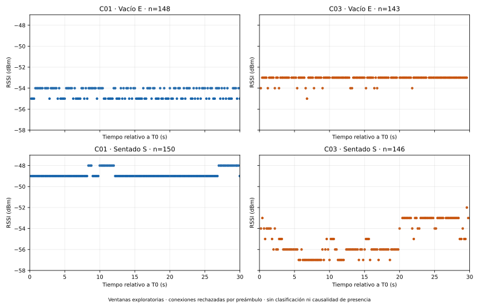
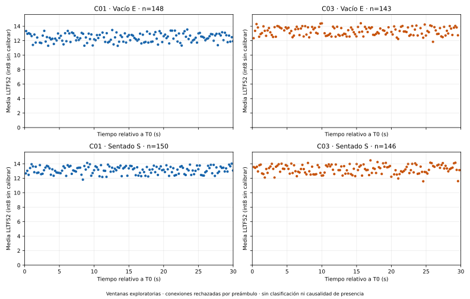
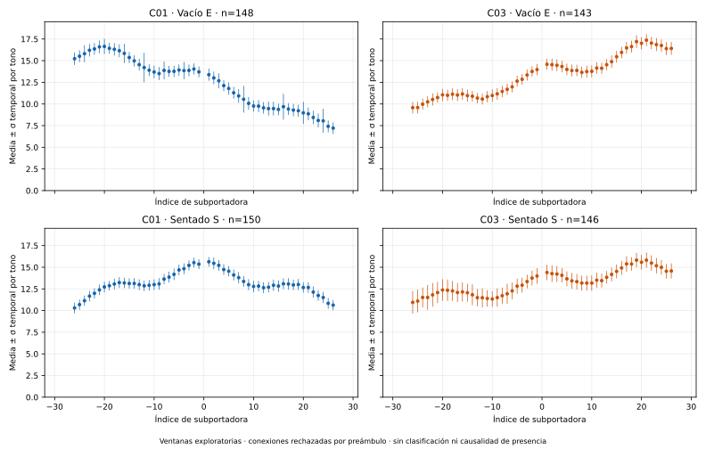
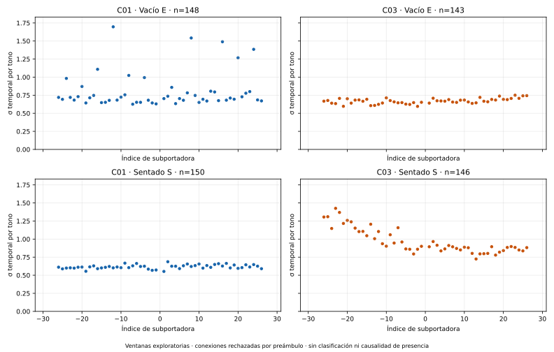
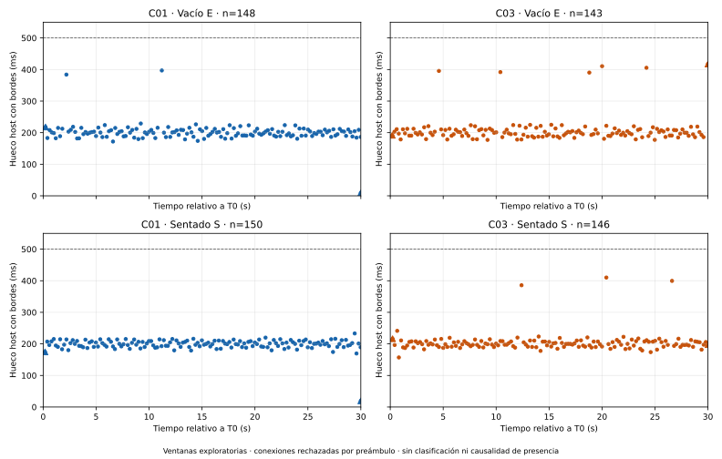

# C03 consolidada y comparación descriptiva C01/C03 por condición

El bundle físico existente C03 pasa integridad, replay, identidad/espacio,
persistencia específica y cierre. Sus ventanas **E=143 y S=146 filas** son
exploratorias elegibles, con etiquetas declaradas por operador. La conexión
completa conserva rechazo estricto por preámbulo. El resultado no habilita
calibración, entrenamiento o producción, ni sustituye C02.

Base revisada local/remota: `6161de0e4637f991eee542046124f62936a84e7e`, rama
`feat/backend-uart-presencia-v4`. El operador reportó `C03_EXIT_CODE=0`; la
auditoría reconstruye los resultados desde bruto y operaciones, independientemente
del código de salida declarado. Esta consolidación no abrió UART ni adquirió.

## Evidencia, conteos y procedencia

Origen C03: `results/local/piloto-rx02-r1-C03-checkpoint-r1/`. Se comprobaron
manifiesto y conjunto completo de archivos, hashes/tamaños, referencias contiguas
al bruto, eventos/estado por replay, recibo durable y prefijo de operaciones,
fuentes y autorización consumida. También se comprueban plan autorizado,
referencia de permiso exclusiva, preflight por metadatos, condiciones e historia
de conexiones declarada por operador. Fuentes C03: 25 hashes coincidentes con
6161de0; las 18 fuentes históricas compartidas con C01 siguen idénticas.

El plan capturado selecciona `rx02-raw-sync-control-checkpoint-2` y
`rx02-c03-checkpoint-entry-1` en plan/procedencia/auditoría. SHA256 del plan:
`f2c7c756fb8acfc4482be5567eaaae3cf445491d34244b56cfb9fef87b96b0da`.
El grant del plan es histórico: `authorization-consumed.json` acredita consumo
antes del intento de apertura; no autoriza otra captura.

C03 contiene 7.414 filas CSI completas, ids 0–7413 consecutivos, queue_drops=0,
289 filas en las ventanas y 7.125 fuera de ellas. Las filas exteriores no se
etiquetan automáticamente E/S ni se agregan para completar una ventana. Hay
7.508 líneas totales: 21 inválidas, dos clasificadas reset, 68 info, dos neutrales,
un READY y las 7.414 CSI. Las dos líneas reset del preámbulo son `ESP-ROM` y
`rst:0x1 (POWERON)`: no equivalen a dos reinicios nuevos. Se conservan junto
al bruto, sin determinar causa/momento físico por su lectura. La declaración
humana de ausencia de desconexión/reset manual no es metrología eléctrica.
No hubo suspensión/fatal en el estado final y no se eliminó el preámbulo.

Los originales C01, C02, diagnóstico, C03, planes y autorizaciones protegidos
se reverificaron: **102 archivos intactos**. Se publican agregados, figuras,
fuentes y referencias/hashes; bruto, matrices, observaciones y referencias por
fila completas permanecen locales. Ningún resultado histórico se sobrescribe.

## Cobertura y etiquetas originales

| Ventana | Filas | Seis bins de 5 s | Máximo hueco, bordes incluidos (ms) |
|---|---:|---|---:|
| C01 E | 148 | 24 / 24 / 24 / 25 / 25 / 26 | 397.045 |
| C01 S | 150 | 25 / 25 / 25 / 25 / 25 / 25 | 233.026 |
| C03 E | 143 | 24 / 24 / 25 / 22 / 25 / 23 | 417.373 |
| C03 S | 146 | 24 / 26 / 23 / 26 / 23 / 24 | 410.152 |

Todas duran exactamente 30 s con T0/T1 originales y mantienen sus referencias
conservadoras. Se reproducen bordes y bins desde tiempos host de lectura;
no son frecuencia RF ni relojes sincronizados. C03 supera mínimos originales
120 filas / 15 por bin y mantiene huecos ≤500 ms; no se cambió ningún umbral,
recortó ventana, rellenó filas ni descartó tonos para conseguir aprobación.
Las máscaras LLTF52 de las cuatro ventanas están completas para todas sus filas.

En C03 ambas etiquetas tienen status=declared, established_before_cue=true,
maintained_through_end_cue=true y cues_heard=true; observation_method es
operator_declaration y timing_uncertainty permanece unknown. La declaración E
se registró 213,610529567 s después de T1; la S, 98,241854211 s después de T1.
Eso no reubica ventanas ni acredita el instante de una transición física por
medición independiente. No se trata el éxito de aplay como prueba humana.
C01 conserva sus propias etiquetas declaradas y la misma limitación.
La elegibilidad exploratoria de las cuatro ventanas se separa del rechazo
estricto de ambas conexiones; no equivale a presencia detectada.

## Checkpoints, cierre y duración

C03 registra 318.943 operaciones (última durable 318.942), 13.466 eventos,
50.885 chunks/sincronizaciones brutas del decorador y **495 checkpoints**.
Máximo sufijo pendiente 65.535 bytes, cota 65.536; pendiente final cero y ningún
escritor en vuelo. Journal de 32.082.299 bytes con SHA256
`fcd32487ee47d5fde847e8d62f578798abc49f57b7bbbd4d2767ef30a5e46a7f`.
Bruto de 6.309.180 bytes con SHA256
`b58008d806e3c54243a8cf00fc4caa3c9a1bfeeeba419db1d8b221d440d490bc`.
Las cotas de eventos, líneas, operaciones y almacenamiento se mantienen.
Los contadores no miden todos los fsync del proceso/dispositivo ni sus duraciones.

Una apertura y un cierre de RX-02, fd liberado, lector detenido, recibo durable
confirmado y **cola final cero**; RX-01 no se abrió. Apertura→cierre confirmado:
1500,153507308 s (C01: 664,114355399 s). El cierre se registra a T1 de S +
10,511922678 s. El journal cubre 1588,008864209 s: incluye espera posterior a
cierre por la declaración final y finalización, sin nuevas lecturas UART.
Las diferencias de duración reflejan también el protocolo manual y sus esperas;
las filas totales de conexión no son más repeticiones independientes.
No se registraron CPU/RSS/fds/hilos comparables durante esta campaña, y no se
extrapolan recursos del diagnóstico o PTY. Se mantienen las limitaciones de
write/fsync/driver síncronos y de recuperación tras interrupción/corte eléctrico.

## Comparación descriptiva por condición

Se reutilizan las definiciones publicadas de C01: RSSI original; amplitud
hypot(Re,Im) sobre int8 Im/Re y los 52 tonos activos LLTF (datos+pilotos,
−26…−1 y +1…+26); DC y guardas excluidos por su máscara nominal. La media por
fila da el mismo peso a esos 52 tonos; después cada fila observada recibe igual
peso. Se informa desviación estándar poblacional temporal por tono y, por
separado, desviación de las medias por fila. No hay interpolación, remuestreo,
normalización, ajuste de ganancia, calibración o entrenamiento. Una máscara
requerida incompleta deja el agregado completo no disponible, sin media parcial.
Estos métodos estaban fijados antes; no se seleccionaron contra C04–C06.

| Sesión/condición | RSSI media ± σ (dBm) | Media LLTF52 por fila ± σ temporal | Media de σ temporal por tono LLTF52 |
|---|---:|---:|---:|
| C01 E | -54.466216 ± 0.498857 | 12.420968 ± 0.571506 | 0.806167 |
| C01 S | -48.806667 ± 0.394912 | 13.124761 ± 0.511928 | 0.617239 |
| C03 E | -53.111888 ± 0.336683 | 13.303123 ± 0.559246 | 0.669413 |
| C03 S | -55.116438 ± 1.496618 | 13.231805 ± 0.595601 | 0.971223 |

Las amplitudes son unidades int8 sin calibrar; σ describe dispersión poblacional,
no error estándar ni intervalo de confianza. No se consideran las filas o tonos
repeticiones independientes para inferencia estadística.

C03−C01 en E: RSSI +1,354328 dB, amplitud +0,882155 y σ temporal media por tono
−0,136755. En S: RSSI −6,309772 dB, amplitud +0,107044 y σ temporal media por tono
+0,353983. Se reportan todas las condiciones con la misma definición y escala.

El contraste dentro de sesión S−E es RSSI +5.659550 dB en C01 y
-2.004550 dB en C03; amplitud +0.703792 y
-0.071318 respectivamente. Los signos no son estables entre sesiones.
Esto no se usa para escoger características, métodos o umbrales, ni para
atribuir los cambios únicamente a presencia.

## Montaje, persistencia y límites de comparabilidad

Ambas sesiones conservan perfil/configuración y criterios idénticos, mismo
RX-02, UART 115200 y orden E→S. Cambian el día/intervalo de adquisición,
esperas, muestras observadas y persistencia: C01 hace fsync de bruto y cada
operación; C03 mantiene bruto síncrono y agrupa operaciones por barreras/cota.
Son sesiones no pareadas ni aleatorizadas; el orden confunde tiempo/ocupación.

Montaje: C01 declaró RX-01 reconectada al hub y RX-02 directa a laptop. C03
declaró mismas posiciones/antenas, TX a algo más de 2 m, RX-02 a la derecha y
USB directo, pero **RX-01 desconectada**. En ambas RX-01 carece de lector/control
simultáneo. La equivalencia geométrica es declarada, sin nueva metrología;
no se afirma un movimiento de antena no declarado. El estado eléctrico/topología
de RX-01 sí difiere. TX usa cargador; potencia no medida en C03. Hubo una pausa
con desconexiones antes del diagnóstico, y C03 declaró continuidad desde ese
diagnóstico sin manipular equipos. No se equipara esa historia a la de C01.

No hay control independiente de AGC/ganancia, entorno RF, alimentación, posición
exacta del cuerpo, postura o movimiento residual. El binario instalado no se
atesta por leer sus fuentes. Las diferencias de persistencia/selección temporal,
montaje declarado y estado RX-01 quedan documentadas sin atribución causal.
No se afirma que checkpoints causen variaciones RF, ni que la diferencia S/E
sea exclusivamente presencia o determine precisión de un detector.

## Figuras con escalas comunes

Cada figura usa cuatro paneles: E arriba, S abajo; C01 izquierda, C03 derecha.
Los límites son iguales en los cuatro paneles de cada métrica y se conservan
sus soportes reales; tiempos relativos a cada T0 no sincronizan las sesiones.







## Particiones, reserva y preservación de C02

C01 y C03 mantienen grupos completos distintos RX02-C01/RX02-C03,
ambos development_future; sin división por filas/ventanas ni mezcla para ajustar
un método. C02 conserva RX02-C02/development_future, rechazo
availability_gap:RX-02, primera etiqueta pending y cola original de 349 bytes.
Su auditoría pasa integridad/replay sin reclasificarla. Las autorizaciones de
C01/C02/diagnóstico/C03 están consumidas. No hay autorización de otra captura.

No se abrieron observaciones de la reserva **C04–C06** para ningún análisis o
selección de características/métodos. El procesamiento y las pruebas se aislaron
con /dev privado, originales en lectura y un audit hook que bloquea accesos a
archivos de reserva local; **cero intentos registrados**. La consolidación solo
admite salida nueva y usa entradas C01/C03 fijas; C02 se audita para preservación.
No se crea un plan de reserva ni se propone abrirla como siguiente paso.

## Reproducción y validación

```bash
.venv/bin/python -B tools/consolidar_c03_comparar_c01.py \
  --output-new results/local/consolidacion-C03-C01-REVISION-NUEVA
```

Este comando solo procesa bundles existentes y requiere una salida inexistente.
Auditorías, matrices, observaciones, logs y comandos exactos del aislamiento
quedan en `results/local/consolidacion-C03-comparacion-C01-r1/`; el resumen público
remite a las referencias por fila locales mediante conteos y hashes canónicos.
La primera ejecución con wrapper genérico no pudo escribir por mantener el
repositorio entero en lectura; no alteró originales. Se permitió después
escritura únicamente en la carpeta nueva manteniendo el aislamiento restante.

**473 pruebas aprobadas**, cero fallos, errores u omisiones, en 51,345 s:
465 previas y ocho nuevas para membresías/cobertura/etiquetas, amplitud52 y σ
independientes, máscara incompleta sin agregado parcial, particiones/contexto,
checkpoints/cierre, cuatro paneles con ejes comunes, C02 preservada y rechazo
de salida existente/entradas de reserva. test_presence_offline excluido por ser
calibración/inferencia fuera de alcance. Matplotlib 3.10.8 y NumPy 2.4.2 locales
fijados, sin instalar dependencias. Figuras RSSI revisadas visualmente.

[Resumen](RX02_C03_C01.resumen.json) · [Validación](RX02_C03_C01.validacion.json) ·
[Hashes de evidencia](RX02_C03_C01.hashes.json).
