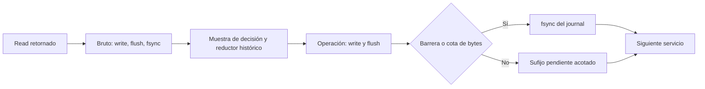

# RX-02: servicio síncrono, reproducción PTY y checkpoint de operaciones

Desde `6403274b8422ddd764397370a1a2741090254c12`. **Solo código, datos
sintéticos en PTY propio y auditoría offline.** C01/C02, sus rechazos y ambas
autorizaciones consumidas permanecen intactos: 34 archivos verificados por
tamaño y SHA-256. No se preparó ninguna adquisición ni se abrió UART física.
Sin firmware nuevo, calibración, entrenamiento o cambios de criterios CSI.

Se implementa una mejora **optativa** del journal, respaldada por una
reproducción que aísla el costo de fsync. No se declara resuelta la causa
física de C02: sus registros no separan todos los mecanismos y el nuevo
camino aún puede bloquearse en bruto, filesystem, planificación o locks.

[Resultados completos, recursos, hashes y fuentes](SERVICIO_RX02_CHECKPOINT_V2.resumen.json),
[validación](SERVICIO_RX02_CHECKPOINT_V2.validacion.json),
[hashes de publicación](SERVICIO_RX02_CHECKPOINT_V2.archivos.json) y
[contrato exacto de persistencia](../docs/PERSISTENCIA_RX02_CHECKPOINT_V2.md).

## Diagnóstico del camino de código

| Operación / lugar | Trabajo y posible retraso | Resultado de inspección |
|---|---|---|
| `UartSession.read_ready` | Guardia de almacenamiento, select no bloqueante, read de hasta 16.384 bytes. | La espera puede ocurrir antes de invocar read; un read corto no demuestra servicio oportuno. Se mantienen tiempos de inicio/retorno. |
| `V4Journal.command`, chunk | Write/flush/fsync del bruto, SHA-256 y después muestra de decisión/reductor. | Barrera síncrona bajo el lock. Se conserva fsync del bruto antes de interpretar. |
| `V4Journal.command`, todas las operaciones | JSON, write/flush/fsync del journal, incluso ticks sin cambios y storage_check. | Amplificador reproducido: varios fsync por iteración retrasan el siguiente read. |
| `StorageGuard._check` | tell/reloj por llamada; statvfs y rglob/stat aproximadamente cada 250 ms; registra otra operación. | Con fsync >250 ms, el siguiente control vuelve a estar vencido; puede repetirse en cada iteración. Cuenta archivos, no recorre el contenido completo del bruto. |
| `UartSession.command` y `StorageGuard.check` | RLock alrededor de reductor y persistencia. | Puede extender cualquier demora protegida. RX-02 no inicia el hilo de arranque dual; el notificador usa colas, no otro reductor. No se demuestra contención de lock en C02. |
| Framer/parser y hashes | Parseo de filas, validación estricta, hash de bytes y referencias; estructuras append-only. | Trabajo por chunk/línea, sin reparsear todo el bruto por tick. Se conserva para trazabilidad. |
| `operate` | Consume eventos desde cursor; select de stdin con 5 ms y lectura solo si está listo; buffer de órdenes hasta 8.192 bytes. | El cursor avanza; no vuelve a serializar toda la historia en cada iteración. Una orden sin LF no bloquea indefinidamente el lector. Stdout puede bloquear por el entorno. |
| `summary()` | Escanea líneas/eventos, copia referencias de ventanas y calcula cobertura. | Crece con historia, pero se usa al terminar ventana y al finalizar, no en cada read/tick. No se elimina ni cachea una decisión histórica. |
| Recibo, manifest y auditoría completa | Hashes, JSON grande, lectura completa de operaciones y replay. | Se ejecutan con el lector detenido; no explican el servicio UART previo al cierre. La finalización estima/serializa estructuras grandes más de una vez. |

No se encontró una auditoría completa por iteración ni un crecimiento cuadrático
demostrado del tick. La reproducción CPU, **con tiempo lógico sintético**, dio:

| Filas sintéticas retenidas | Tick mediano | JSON de registro fijo | Resumen completo mediano |
|---|---:|---:|---:|
| 500 | 1,086 µs | 1,907 µs | 1,072 ms |
| 5.000 | 1,219 µs | 2,245 µs | 3,004 ms |
| 18.000 | 1,246 µs | 2,186 µs | 9,237 ms |

Es una microprueba de estructura/CPU, no el ensayo de reloj real ni una
garantía de latencia del sistema. El resumen crece de forma visible; no respalda
atribuirle los cientos de ms entre operaciones de C02 sin más traza.

## Reproducción offline y separación de mecanismos

`rx02_service_lab.py` usa un solo PTY creado por el proceso, con identidad/fd
de fixture verificados; la implementación de prueba rechaza rutas distintas
del PTY propio. No hay udev, búsqueda de ESP o sustitución por RX-01.

El productor independiente genera **5 filas/s**, periodo objetivo de **200 ms**,
con tamaños exactos alternados **750, 874, 993 y 751 bytes**, dentro del rango
observado en C02. El contenido int8 es inventado; no se copiaron matrices IQ
físicas para generar el fixture. Se escribe en fragmentos 128, 256, 256 y resto,
con objetivos separados 20 ms; el resto del periodo queda libre. Registra el
retraso real del productor y se detiene si pierde un periodo, sin crear una
frecuencia artificial para recuperar retrasos.

El bucle tiene una pausa de 5 ms que aproxima el sondeo interactivo existente.
Reloj `time.monotonic_ns` sin aceleración. Cada mecanismo se inyecta por
separado; las ejecuciones se hacen secuencialmente para evitar contención
mutua de benchmarks. Los retardos son condiciones artificiales, **no una
estimación del tiempo aislado de fsync o parser de C02**.

La instrumentación final sustituye funciones directamente y usa presupuestos
finitos de muestras; no retiene un objeto Mock por llamada. Las cotas de muestras
y cualquier overflow quedan registrados. No hubo overflow en la matriz final.

| Demora controlada | Antes: resultado / máximo entre pasos | Revisión 2: resultado / máximo entre pasos |
|---|---|---|
| Ninguna | Sin fatal / 18,398 ms | Sin fatal / 19,031 ms |
| fsync de operaciones, 420 ms por llamada | `availability_gap:RX-02` / **1296,524 ms** | Sin fatal / **438,121 ms** |
| fsync bruto, 300 ms por llamada | Sin fatal / 331,741 ms | Sin fatal / 320,575 ms |
| Serialización de cada operación, 200 ms | `close_budget_exceeded:RX-02` / 650,307 ms | Mismo rechazo / 621,769 ms |
| Procesamiento de chunk, 300 ms | Sin fatal / 328,162 ms | Sin fatal / 320,551 ms |
| statvfs/control de espacio, 300 ms | Sin fatal / 329,515 ms | Sin fatal / 321,196 ms |
| Retención de lock, 1.200 ms | `availability_gap:RX-02` | Mismo rechazo |
| fsync bruto, 1.200 ms por llamada | `availability_lost:RX-02` | Mismo rechazo |

En el caso de lock, la última llamada que suspende dura 1231,898 / 1216,786 ms;
mirar solo intervalos entre inicios de pasos omitiría ese último bloqueo. Por
eso se conservan ambas medidas, los reads, sus filas y el resultado original.
Las pruebas sin fatal de esta matriz breve no solicitan ventanas ni certifican
cobertura de presencia. La serialización lenta sigue haciendo fallar el drenaje
de cierre: tampoco se presenta como corregida.

La medida directa entre retorno de un read e inicio del siguiente en el caso
de journal lento baja de **1297,050 a 468,300 ms**. El mayor hueco entre filas
completas baja de 1297,078 a 468,332 ms. El generador sigue igual; no se reajusta
frescura, cobertura, T0/T1 o cadencia para obtenerlo. Los tiempos de cierre y
duración de cada ensayo se publican por separado; un caso que suspende antes
no tiene la misma exposición que uno que alcanza su duración prevista.

Los bytes generados que no llegaron a leerse al detener el fixture permanecen
separados del bruto capturado. No se convierten en observaciones recibidas ni
se completa una cola con ellos. Todos los bytes retornados por read quedan
referenciados por el journal y verificados en replay.

## Mejora mínima implementada

La revisión `rx02-raw-sync-control-checkpoint-2` conserva las fuentes históricas
sin cambios. Un decorador del journal reutiliza exactamente transporte,
reductor, almacenamiento, señales y dueño del cierre. No añade un escritor en
segundo plano ni una cola de entrada que pueda crecer durante una demora.

El bruto sigue write/flush/fsync por chunk **antes de la decisión**. El journal
de operaciones sigue escribiendo/flush por registro y hace fsync:

- antes de que su sufijo pendiente supere 65.536 bytes;
- después de solicitudes/declaraciones y barreras explícitas de control;
- antes del recibo durable de cierre y de la finalización.

Se evita así fsync propio por cada tick y control de espacio, que fue el
amplificador aislado en la reproducción. No se cambia la gramática de datos o
la lógica que decide frescura, cobertura, etiqueta o rechazo. La regresión
comprueba estado/elegibilidad iguales al auditor original para el mismo journal.

**Esto cambia la durabilidad de operaciones**: ticks, T0/T1 y avisos derivados
pueden ser provisionales hasta una barrera. El sufijo sin checkpoint puede
perderse/truncarse al morir el proceso o fallar la alimentación. La cota es
en bytes, no en segundos; no es una garantía de recuperar directorios después
de un corte eléctrico. El [contrato](../docs/PERSISTENCIA_RX02_CHECKPOINT_V2.md)
precisa las condiciones y las garantías que no existen.



Para el cierre se conserva además el orden: liberación observada del fd →
checkpoint → recibo durable → aviso específico de RX-02. Si falla persistencia,
se libera el recurso pero no se crea recibo/manifiesto de éxito ni se anuncia
un cierre durable que no se pudo registrar.

Las cotas nuevas de recursos son 16.384 bytes por chunk/registro, 65.536 de
sufijo, 25.000 líneas, 100.000 eventos y 500.000 operaciones. Detienen en vez
de eliminar historia. El chunk que obliga a detener por historia se conserva
primero en el bruto. No se reclama un techo exacto de RSS en bytes; las
estructuras, sus tamaños y cantidades quedan acotados. El resumen y el replay
completo siguen usando memoria después de cerrar, bajo los límites del bundle.

La variante exige opt-in explícito y deja intacto el CLI físico anterior.
Hay política nueva con hashes y `checkpoint-status.json`, cubiertos por el
manifiesto. `audit_checkpoint_rx02` valida política, fuentes, recursos,
prefijo final durable y auditoría histórica. No se creó ningún plan local de
adquisición o reemplazo, ni se activó la variante en las ESP.

## Ensayo sostenido con reloj real

**246,799890362 s de servicio activo**, 247,312086783 s incluyendo finalización
y auditoría. Sin demora artificial, instrumentación acotada y productor de 5 Hz.
Se generaron/registraron **1.234 filas sintéticas**, dos ventanas originales de
30 s y dos etiquetas simuladas desde el controlador de pruebas; no humanas.

| Medida del ensayo nominal | Resultado |
|---|---|
| Intervalo entre pasos, mediana / p99 / máximo | 5,286 / 8,645 / 24,033 ms |
| Máximo retorno → inicio del read siguiente | 145,466 ms, incluye huecos normales entre fragmentos |
| Ventana E / S: filas y bins de 5 s | 150/150; 25,25,25,25,25,25 en ambas |
| Ventana E / S: hueco máximo con bordes | 204,674 / 204,030 ms |
| Resultado conservador E | **Ineligible: `late_row_processing`** |
| Resultado conservador S | Elegible exploratoria **sintética**, sin usos de modelo habilitados |
| RSS muestreado durante servicio | 30.860…36.104 KiB (30,1…35,3 MiB) |
| Pico de proceso, incluida auditoría posterior | 82.460 KiB; no se confunde con el pico del servicio |
| CPU de proceso, incluida auditoría | 12,189121 s; no es una medida del kernel/disco aislada |
| Fds / hilos en las muestras de servicio | 13 / 2, sin crecimiento observado |
| Operaciones / bruto | 49.719 / 1.039.140 bytes |
| Checkpoints / fsync brutos de revisión 2 | 71 / 4.937 |
| Sufijo máximo / final | 65.534 / 0 bytes |
| Aperturas / cierres / cola final | 1 / 1 confirmada / 0 bytes |

El último dato de E, id sintético 680, retornó **2,330489 ms antes de T1** y
su muestra de decisión se tomó **0,254399 ms después de T1**. El auditor lo
rechaza por procesamiento tardío pese a su cobertura interna correcta. Se
mantiene esa decisión, sin mover T1, eliminar la fila, relajar el criterio o
repetir el ensayo para conseguir dos ventanas elegibles.

### Ensayos preliminares conservados

Se retienen 16 ensayos exploratorios anteriores a la instrumentación acotada,
con sus hashes y resultados originales. Usaban mocks que guardaban historial
por llamada: esa era una fuente de crecimiento del **instrumento de prueba**,
no un diagnóstico del capturador físico de C02.

Uno de ellos, con demora de journal de 420 ms, se detuvo a los 137,566 s de
servicio por `pilot_coverage_failed`: 150 filas y bins correctos, pero hueco
629,547 ms y etiqueta pendiente. Su RSS crecía hasta 143.684 KiB; **se excluye
de la comparación final de memoria/rendimiento**, conservando el rechazo.
No se sobrescribió ni se hizo pasar por un ensayo físico. Se archivaron la
fuente del prototipo cuyo hash consta en su política y las fuentes finales.
El nuevo ensayo nominal es otra condición explícita de laboratorio, sin esa
demora; no sustituye ni aprueba el de estrés.

## Regresiones, fallos y límites

**433 pruebas Python aprobadas**, cero fallos, errores u omisiones: 26 módulos
de adquisición, parser, framing, ventanas, replay, arranque, transporte,
diagnósticos y 17 pruebas nuevas de revisión 2. Se excluyó explícitamente
`test_presence_offline`, cuyas pruebas de calibración/inferencia quedan fuera
de este cambio. No se ejecutó un modelo sobre C01/C02.

Se comprobaron escrituras cortas, fsync fallido de bruto/journal, límite de
historia con bruto completo conservado, fallo de serialización, interrupción
en checkpoint, fallo de recibo, estado durable falso rehasheado, cierre único,
órdenes inválidas recuperables y dos ventanas contra el reductor original.
Dos pruebas con SIGKILL verifican que un prefijo parcial y bruto por delante
del journal nunca se conviertan en un bundle aprobado. Son muertes de proceso;
no simulan pérdida de energía/caché de dispositivo.

Bubblewrap volvió a fallar al crear namespaces, antes de ejecutar pruebas.
Se conservaron error y código 1; no se afirma aislamiento Bubblewrap de las
433 pruebas directas. El propio laboratorio restringe endpoints a PTY del
proceso y nunca usa preflight físico.

Los resultados respaldan reducir fsync repetidos de operaciones como mejora
pequeña y verificable. **No respaldan garantizar estabilidad física de RX-02,
atribuir la causa única de C02 o aprobar otra captura.** El fsync del bruto,
writes, locks y planificación siguen siendo síncronos. Una pausa larga aún
debe provocar rechazo y lo hace en los controles negativos. No hay nuevo
umbral de aceptación, etiqueta reconstruida o autorización reutilizada.

## Reproducir sin dispositivos físicos

```bash
.venv/bin/python -B tools/reproducir_servicio_rx02.py \
  --output-new results/local/LAB-ANTES-NUEVO --variant legacy \
  --mechanism ops_sync --delay-ms 420 --duration 6 --poll-ms 5
.venv/bin/python -B tools/reproducir_servicio_rx02.py \
  --output-new results/local/LAB-DESPUES-NUEVO --variant checkpoint2 \
  --mechanism ops_sync --delay-ms 420 --duration 6 --poll-ms 5
.venv/bin/python -B tools/reproducir_servicio_rx02.py \
  --output-new results/local/LAB-SOSTENIDO-NUEVO --variant checkpoint2 \
  --duration 265 --windows --request-delay 45 --poll-ms 5
PYTHONPATH=src:tests .venv/bin/python -B -m unittest test_rx02_checkpoint
```

Los outputs deben ser nuevos; no se reemplazan ensayos que fallan. Los datos,
políticas, manifest, auditorías y recursos completos quedan bajo
`results/local/laboratorio-servicio-rx02-r1/`. Solo se versionan informes,
referencias/hashes, estadísticos y código de reproducción.
